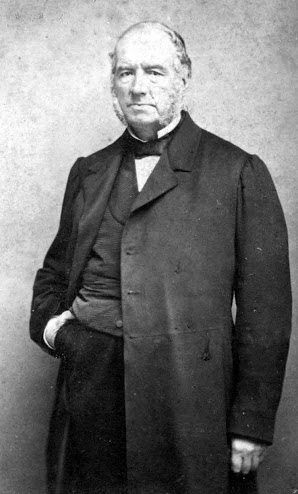

# Spatial pattern sensitivity and metrics {#sec-human-spatial-metrics}



## Spatial metrics overview {#sec-human-metrics-overview}

How can we evaluate the design of a camera? Lord Kelvin put it in that lovely style of the British upper crust

> when you can measure what you are speaking about, and express it in numbers, you know something about it; but when you cannot measure it, when you cannot express it in numbers, your knowledge is of a meagre and unsatisfactory kind (Popular Lectures and Addresses "Electrical Units of Measurement" (1889).)

<!--
Thomson, W. (1891). Popular Lectures and Addresses (Vol. 1, 2nd ed., pp. 80–81). Macmillan and Co.
-->

**Goodhart’s Law** as a warning: *"When a measure becomes a target, it ceases to be a good measure."*

The answer depends on your intended use. If the camera is intended to create images that people see, then the design must be guided by the capabilities and limits of the human eye. If the camera serves as input to a robot, or a self-driving car, or a medical image diagnostic system, we expect the camera's design to be evaluated by how well it assists those systems.

Engineering progress relies on measurement. Improving a system is an iterative process that involves a loop of designing, measuring, and redesigning. Consequently, performance metrics are fundamental to nearly all engineering disciplines.

It is also a common principle that systems of even moderate complexity have more than one performance measure. We are often forced to make trade-offs, for example, between a system's speed and its accuracy. We see this in modern AI systems that offer a choice between a 'fast' mode and a more thorough 'thinking' mode.

Imaging systems are no different. They present numerous trade-offs. For instance, increasing a sensor's spatial resolution can reduce the number of photons captured per pixel, thus lowering the signal-to-noise ratio (SNR). Conversely, increasing SNR by using wider color filter bandwidths may reduce color accuracy.

When there is only one parameter to optimize, assessing system design is straightforward. However, most systems involve optimizing multiple parameters simultaneously. A design change might improve some metrics while degrading others, making it difficult to determine an overall improvement.

This complexity is reflected in the field of image quality metrics. Many different metrics exist. Some assess a specific aspect of system performance, guiding the design of a particular component. Others, however, aim to capture the general notion of image quality as a human would judge it. The most famous of these—the Structural Similarity Index Measure (SSIM), with over 100,000 citations—is a prime example.

Engineers, computer scientists, and product managers often desire a single number they can optimize and market. As a student or young researcher, you might be tempted to resist this simplification. A word of advice: understand the limitations of single-number metrics, but don't let their imperfection stall your progress. Use them as the valuable, albeit incomplete, tools they are.

In the image processing section, I introduce a number of image systems metrics that are designed to evaluate the system and its components directly (@sec-imgprocessing-metrics-overview). Those metrics might assess the signal-to-noise (SNR) of a pixel, or the MTF of a lens.

In this chapter and in @sec-human-color-metrics, I review metrics that are designed with the human viewer in mind: How sharp will the image appear? Will the noise be visible? Do the colors in the rendering match those in the original? This chapter covers spatial pattern sensitivity and metrics that depend on spatial (and temporal) image properties, such as sharpness, contrast sensitivity, and noise visibility. After we develop the principles of human wavelength encoding (@sec-human-wavelength-encoding), @sec-human-color-metrics covers color representations, CIELAB, and Spatial-CIELAB (S-CIELAB).

## Spatial sensitivity in the transform domain {#sec-human-csf}
The usefulness of the analyses in the transform domain, in engineering generally and optics specifically, led vision scientists to ask whether measurements using harmonics could be useful for understanding and characterizing the human visual system. Perhaps the first person to see the potential application was the image systems engineer Otto Schade.  This is the person who developed the concept of the modulation transfer function (MTF) for  image systems engineering questions (@sec-MTF).

I created four Google docs with historical information about CSF measurements, how to download the historical data, and how to imlement the modern models of the historical and more modern data.  Integrate those pages here and write some Matlab scripts to create figures.

Show the data he collected of the CSF (1/MTF) he measured that I include in FOV.  Maybe in the human spatial encoding chapter.

The use of harmonics to probe the visual system is quite different from their use in studying typical systems.  At many points in this volume I have pointed out that harmonics are particularly valuable stimuli for space-invariant linear systems @sec-appendix-spaceinvariance-overview. These systems have an input and an output. THe use of harmonic stimuli in human vision faces two significant limitations.  First, as we have just seen, the system is not at all space-invariant (@fig-cone-mosaic-density). It is justifiable to use harmonics as special stimuli over small regions of the retina, which can be close to space-invariant. Stimuli that span more than a degree or two will not have the special property (harmonics being nearly eigenfunctions) that make them so useful in systems analysis.

Second, even at the earliest stages of vision the neural encoding is not restricted to a single system.

### Contrast sensitivity functions (CSF)  {#sec-contrast-sensitivity}
Optical scientists use both the space domain (PSF) and the transform domain (MTF) to study their system, and vision scientists use both domains as well. The nonuniformity of the optical blur, coupled with the nonuniformity of the cone spatial sampling, imply that shift-invariant methods only make sense over patches of the visual field. As a result, the carefully controlled harmonics used in vision experiments are modulated over relatively small regions of space.

There are several ways in which this modulation is accomplished in experiments, though perhaps the most common is to use a **Gabor function**; named after Denis Gabor, the Nobel Laureate credited with the discovery of the laser.

$$
\begin{aligned}
g(x,y) &= \exp\!\left(
  -\frac{(x - x_0)^2 + (y - y_0)^2}{2\sigma^2}
\right)
[1 + a \cos\!\big(2\pi f x +  \phi\big)]
\end{aligned}
$$ {#eq-gabor-function}

Gabor functions are harmonics modulated by a Gaussian.  The standard deviation of the Gaussian ($\sigma$) controls the spatial spread; the frequency of the harmonic $f$, controls the center frequency of the image. The phase term, $\phi$, controls the spatial relationship between the harmonic and the peak of the Gaussian.  The central position in the visual field is $(x_0,y_0)$, and the amplitude of the harmonic is controlled by $a$.

Figure:  Show images of different Gabors.

Show classic contrast sensitivity functions  (CSF) measured with Gabor patches shown here.

Note:  Should we adjust $f$ and $\sigma$ together, or should we fix $\sigma$ and adjust $f$ on its own.  Thinking about the space-variant part of the human visual system, we realize both are important parameters.

### Vernier acuity {#sec-vernier-acuity}

Gerald and Suzanne lead the discussion of Vernier acuity.

::: {.callout-note title="Pierre Vernier" collapse=true}

https://www.fisicanet.com.ar/biografias/cientificos/v/vernier-pierre.php

Something about Vernier calipers and the story of Pierre Vernier.

{#fig-vernier width="60%"}

Historical

https://en.wikisource.org/wiki/1911_Encyclop%C3%A6dia_Britannica/Vernier,_Pierre

:::

## Spatial image quality metrics {#sec-human-spatial-quality-metrics}

I have links to both original measurements, modern measurements (Standard Spatial Observer), and many commercial versions of spatial metrics that are implemented in ISETCam. This section will describe those.

```{=html}
<!--
Material collected for incorporating here.  There are even some tables describing many of the metrics.  Helped from FISE-Human, I think.  Maybe Gemini, too, not sure.

Section 1:  https://docs.google.com/document/d/1vbsVXmAgqLxVCneZ8HmjsBioLJv-FAHhoLatnnXlx7c/edit?usp=sharing 
Section 2:  https://docs.google.com/document/d/1j5DB83pqyV0VfGew10sO0PTrh20jbB_JRGUiIvwRzSw/edit?usp=sharing 
Section 3:  https://docs.google.com/document/d/1qASkzf8CM2NUnT7FzNa4a3GIDfyfn5Ps0_uBGXP4qkM/edit?usp=sharing
Section 4:  https://docs.google.com/document/d/1jYQCZ6ZnKL9VJjcCyapttxKmELhJi2jD5o7rsI0V_38/edit?usp=sharing  
-->
```

```{=html}
<!--
Thinking about Bob Hunt.  https://www.perplexity.ai/search/robert-hunt-from-kodak-researc-pIEYaPICQzWNhpK4mWIcCQ 

That single channel metrics guy Barten
Based on your description, I'm quite confident you're thinking of **Peter G. J. Barten** and his work on image quality, particularly his **Square-root integral (SQRI)** model.

He fits your description perfectly:
* **Name:** "Barten" is very similar to your recollection of "Bartlett."
* **Field:** He was a highly influential display consultant and engineer who specialized in spatial image metrics and visual sensitivity.
* **Timeframe:** His key book, *"Contrast Sensitivity of the Human Eye and Its Effects on Image Quality,"* was published in 1999, and his SQRI model was widely discussed in the 1990s and 2000s, placing him exactly in the "about 20 years ago" period.
* **Model:** His work focused on luminance (black and white) and is famous for a single metric that predicts perceived image quality. This metric is precisely what you described: **a single integral**.

### The Barten Model and the "Square-root integral" (SQRI)

The simple formula you're remembering is likely the **Square-root integral (SQRI)**. This model calculates a single number (often called $J$) to represent the perceived quality of an image on a display.

The model is conceptually a single-channel integral across spatial frequencies. In simple terms, it does this:

1.  **It uses the Contrast Sensitivity Function (CSF):** Barten developed a comprehensive (though complex) set of equations to model the human eye's contrast sensitivity function ($CSF$), which is our ability to see fine detail (high spatial frequencies) versus coarse detail (low spatial frequencies). This is the "visual sensitivity model" part.
2.  **It Compares Display to Eye:** The SQRI formula integrates the ratio of the display's modulation transfer function ($MTF$, what the display can *show*) to the eye's modulation threshold ($M_t$, what the eye can *see*) at each spatial frequency.
3.  **The "One Integral":** The simplified form of the SQRI metric is an integral that looks conceptually like this:

    $$J \propto \int \sqrt{\frac{\text{Display Contrast}(f)}{\text{Human Threshold Contrast}(f)}} \, d(\log f)$$

This single number, $J$, is expressed in "Just Noticeable Differences" (JNDs) and provides a powerful metric for "how good" an image looks, which is exactly what he gave many seminars about.

Does Peter B. Barten and the Square-root integral model sound like what you were thinking of?
-->
```

### Classical single-channel metrics

That single channel guy with his metric and formula. Repeated everywhere. Barten. SQRI.

Earlier single channel. Value of multiple channel metrics? Existence?

### Modern structural and perceptual metrics

SSIM and MS-SSIM

LPIP goes here because it is human judgments of image quality?

Pyramid from Beau? Multi-parameter

I forked the [Mantiuk github repository:](https://github.com/isetbio/stelaCSF) [The Mantiuk repository is here:](https://github.com/gfxdisp/stelaCSF.git). His metric goes here, I think. His code reads classic datasets. Maybe we include the data files in the book?

The surprising metric LPIPS

## Temporal sensitivity and metrics {#sec-human-temporal-metrics}

Temporal MTF metrics, flicker visibility, and motion blur.

