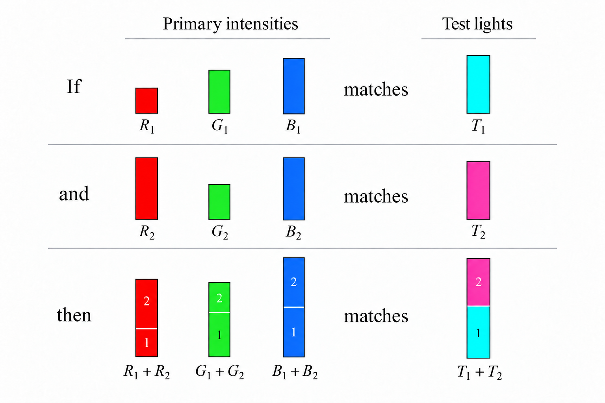

# Wavelength encoding {#sec-human-wavelength-encoding}



```{=html}
<!--
# The chapters with David have a lot of the material for this chapter.
-->
```
*The material currently in place here is not yet ready for review.* 

To learn more about human wavelength encoding, please refer to the chapters in [Foundations of Vision](https://foundationsofvision.stanford.edu){target="_blank"}.  
-   [Wavelength encoding](https://wandell.github.io/FOV-1995/chapter-4-wavelength-encoding.html){target="_blank"}

## Wavelength encoding overview {#sec-human-wavelength-encoding-overview}
When Thomas Young delivered his Bakerian Lectures (1801–1803), he introduced two propositions that challenged British orthodoxy: first, that light travels as a wave; and second, that human color vision is trichromatic because the retina possesses three distinct types of wavelength sensors. The first was a resurrection of Huygens' idea that the establishment had rejected.  The second was a novel insight about color perception that flowed naturally from the first.

Both ideas were met with fierce resistance. Henry Brougham's scathing broadsides in the *Edinburgh Review* battered Young's reputation and contributed to his withdrawal from public optical debate for more than a decade (the quotation and the story are in @nte-young-trials, in @sec-evidence-wave-theory).

Young's wave theory was vindicated a decade later. Fresnel, working independently in France, supplied the mathematics of diffraction and interference, and Arago's observation of the bright spot at the center of a circular shadow firmly re-established the wave theory of light (@sec-optics-poisson-spot).

The color idea took longer to settle. Maxwell's experiments, described below, showed that the three-dimensionality of color is a property of the eye, not of light.

My enthusiasm for Maxwell as a color scientist is based on the fact that (a) he settled, once and for all, the question of the biological basis of trichromacy, and (b) he did so in a way that established a clear conceptual structure and experimental methodology that we still use today [@maxwell1857-XVIIIExperimentsColourPerceived; @maxwell1860-IVTheoryCompound]. Maxwell then collaborated with Thomas Sutton to produce the first color photographs [@fig-maxwell-sutton], demonstrating that his understanding was true and useful [@Sutton1861-color; @maxwell1861-three-primary][^feynman-maxwell], though the significance of that color demonstration is controversial [@Klein2023-lt].

[^feynman-maxwell]: I think of Feynman's comment, "What I cannot create, I do not understand".

Maxwell did the color work just prior to taking on the challenges of unifying the equations for electricity and magnetism and discovering that light is also electromagnetic radiation. I am so pleased that color science can call Maxwell one of our own.

::: {.callout-note title="History of color science"}
The idea that human color vision is limited by the eye, rather than by the light, has a long history. The history is chronicled in a fascinating chapter by [@mollon2003-Origins-Color], and there is much to be learned from his account. One interesting point is that much practical knowledge was available and used by commercial firms prior to scientific analyses. The exchange between commerce and science is present throughout the field of image systems and far beyond.

I have made a few additional observations, building on Mollon's work, in @sec-resource-color-history.
:::

## Maxwell's color matching experiments
Thomas Young's suggestion that three-dimensional color vision is of biological origin was just that, a suggestion. It was based on his understanding that light comprised waves and that the frequency of these waves was a continuous variable. He was aware that color could be reproduced using only three primary colors.  To reconcile the continuous representation of light with the low dimensional representation of color, he wrote

> Now, as it is almost impossible to conceive each sensitive point of the retina to contain an infinite number of particles, each capable of vibrating in perfect unison with every possible undulation, it becomes necessary to suppose the number limited for instance to the three principal colours … [@young1802-bakerian-light].

Even apart from the scurrilous attacks from Brougham (@nte-young-trials), serious scientists still held on to the idea that light itself was three-dimensional [@brewsterIVNewAnalysis1834], or that color vision had more than three dimensions [@helmholtzLXXXITheoryCompound1852].  It was James Clerk Maxwell who developed the experiments and conceptual framework that settled the matter.

](images/human/03-wavelength-encoding/matching/maxwell-wheel.jpg){#fig-maxwell-wheel width=60%}

First, Brewster had proposed that although light comprised a continuum of wavelengths, these were not independent of one another.  Rather, he postulated that there were only three fundamental types of light (red, yellow, and blue). Each of these, he proposed, had energy distributed across the spectrum. To test this idea, Maxwell performed a simple experiment. He used his spinning color top to create metameric matches (for example, matching a combination of Vermilion, Emerald Green, and Ultramarine in the outer ring against a mixture of Chrome Yellow, Black, and White in the inner circle). He then viewed the metamers through a color filter.  If the two matching lights were physically identical—or if light itself were physically three-dimensional such that visually indistinguishable lights had the same physical composition—any color filter placed in front of the eye would attenuate both lights identically, and the match would hold[@maxwell1855-experiments]. He reported

> The tints which before appeared identical will now be manifestly different, and will require alteration, to reduce them to equality. [@maxwell1855-experiments].

Because the colored glass broke the match, the two lights had to be physically distinct in their spectral composition. Therefore, their initial visual identity could not be a property of the light itself; it existed solely because the human eye collapses a continuous wavelength spectrum down to three physiological sensations. Young must have got it right.  Or as Maxwell put it:
 
 > It seems almost a truism to say that colour is a sensation; and yet Young, by honestly recognising this elementary truth, established the first consistent theory of colour. So far as I know, Thomas Young was the first who, starting from the well-known fact that there are three primary colours, sought for the explanation of this fact, not in the nature of light, but in the constitution of man. [@maxwell1872-colorvision]

## Color matching experiments
Following his experiments with the color wheel, Maxwell constructed an apparatus in which he could more easily measure the relationship between the intensity of the three primary lights and a test light.  It explains how in 1860 Maxwell managed to device a rig to independently control the intensities of spectral lights and form a visual match [@maxwell1860-IVTheoryCompound; @wandell2024-cone-fundamentals].

Conceptually, Maxwell explained that a test light of some intensity, $I_t$ can be matched by adjusting the intensities of three fixed, primary lights that were mixed together. He explained that an experiment in which one associates a light with the three intensities of the primaries quantifies the light's appearance

> It appears therefore that the result of any mixture of colours, however complicated, may be defined- by its relation to a certain small number of well-known colours. Having selected our standard colours, and determined the relations of a given colour to these, we have defined that colour completely as to its appearance. Any colour which has the same relation to the standard colours, will be identical in  appearance, though its optical constitution, as revealed by the prism, may be very different [@maxwell1860-IVTheoryCompount].

.
](images/human/03-wavelength-encoding/matching/44_cone-color-matching-apparatus-box.png){#fig-color-matching-experiment width="80%"}

Maxwell built an apparatus to perform a series of matches between a variety of spectral lights; his experiments tested the principle of superposition [@maxwell1860-IVTheoryCompound]. 

{#fig-color-matching-additivity width=70%}

Maxwell summarized his spectral color matching measurements, made on himself and (I believe) his wife,  by three curves, one for each primary light. The curves measure the intensity of a primary light that was needed to make the match to a monochromatic test light. The curves were derived from his data - the instrumentation did not allow him to make this measurement directly. Today, we call these curves the *color matching functions (CMFs)*.  The critical idea in these measurements is linearity.  We can describe 

## Calculations

## Maxwell and color science

Maxwell recognized that it is possible to create a science based on perceptual observations, and that this science was an exploration of our conscious experience.

> If the sensation which we call colour has any laws, it must be in our own nature which determines the form of these laws; and I need not tell you that the only evidence we can obtain respecting ourselves is derived from consciousness.
>
> The science of colour must therefore be regarded as essentially a mental science. It differs from the greater part of what is called mental science in the large use which it makes of the physical sciences, and in particular of optics and anatomy. But it gives evidence that it is a mental science by the numerous illustrations which it furnishes of various operations of the mind [@maxwell1872-colorvision].


