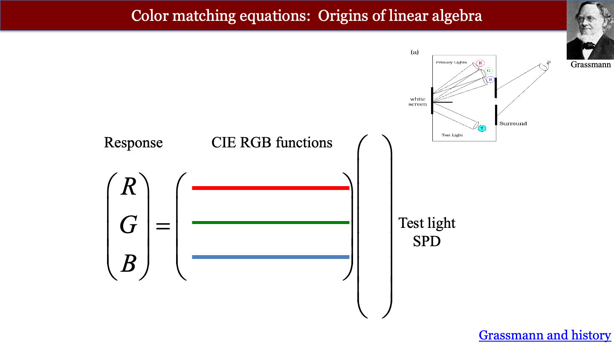
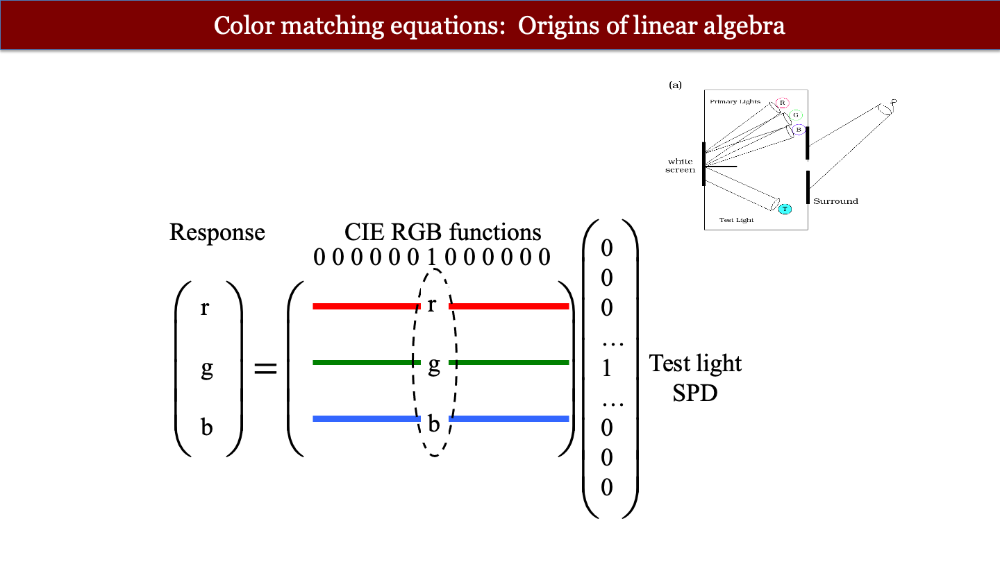

# Wavelength encoding {#sec-human-wavelength-encoding}



```{=html}
<!--
# The chapters with David have a lot of the material for this chapter.
-->
```
*The material currently in place here is not yet ready for review.* 

To learn more about human wavelength encoding, please refer to the chapters in [Foundations of Vision](https://foundationsofvision.stanford.edu){target="_blank"}.  
-   [Wavelength encoding](https://wandell.github.io/FOV-1995/chapter-4-wavelength-encoding.html){target="_blank"}

## Wavelength encoding overview {#sec-human-wavelength-encoding-overview}
When Thomas Young delivered his Bakerian Lectures (1801–1803), he introduced two propositions that challenged British orthodoxy: first, that light travels as a wave; and second, that human color vision is trichromatic because the retina possesses three distinct types of wavelength sensors. The first was a resurrection of Huygens' idea that the establishment had rejected.  The second was a novel insight about color perception that flowed naturally from the first.

Both ideas were met with fierce resistance. Henry Brougham's scathing broadsides in the *Edinburgh Review* battered Young's reputation and contributed to his withdrawal from public optical debate for more than a decade (the quotation and the story are in @nte-young-trials, in @sec-evidence-wave-theory).

Young's wave theory was vindicated a decade later. Fresnel, working independently in France, supplied the mathematics of diffraction and interference, and Arago's observation of the bright spot at the center of a circular shadow firmly re-established the wave theory of light (@sec-optics-poisson-spot).

The color idea took longer to settle. Maxwell's experiments, described below, showed that the three-dimensionality of color is a property of the eye, not of light.

My enthusiasm for Maxwell as a color scientist is based on the fact that (a) he settled, once and for all, the question of the biological basis of trichromacy, and (b) he did so in a way that established a clear conceptual structure and experimental methodology that we still use today [@maxwell1857-XVIIIExperimentsColourPerceived; @maxwell1860-IVTheoryCompound]. Maxwell then collaborated with Thomas Sutton to produce the first color photographs [@fig-maxwell-sutton], demonstrating that his understanding was true and useful [@Sutton1861-color; @maxwell1861-three-primary][^feynman-maxwell], though the significance of that color demonstration is controversial [@Klein2023-lt].

[^feynman-maxwell]: I think of Feynman's comment, "What I cannot create, I do not understand".

Maxwell did the color work just prior to taking on the challenges of unifying the equations for electricity and magnetism and discovering that light is also electromagnetic radiation. I am so pleased that color science can call Maxwell one of our own.

::: {.callout-note title="History of color science"}
The idea that human color vision is limited by the eye, rather than by the light, has a long history. The history is chronicled in a fascinating chapter by [@mollon2003-Origins-Color], and there is much to be learned from his account. One interesting point is that much practical knowledge was available and used by commercial firms prior to scientific analyses. The exchange between commerce and science is present throughout the field of image systems and far beyond.

I have made a few additional observations, building on Mollon's work, in @sec-resource-color-history.
:::

## Maxwell's color matching experiments
Thomas Young's suggestion that three-dimensional color vision is of biological origin was just that, a suggestion. It was based on his understanding that light comprised waves and that the frequency of these waves was a continuous variable. He was aware that color could be reproduced using only three primary colors.  To reconcile the continuous representation of light with the low dimensional representation of color, he wrote

> Now, as it is almost impossible to conceive each sensitive point of the retina to contain an infinite number of particles, each capable of vibrating in perfect unison with every possible undulation, it becomes necessary to suppose the number limited for instance to the three principal colours … [@young1802-bakerian-light].

Even apart from the scurrilous attacks from Brougham (@nte-young-trials), serious scientists still held on to the idea that light itself was three-dimensional [@brewsterIVNewAnalysis1834], or that color vision had more than three dimensions [@helmholtzLXXXITheoryCompound1852].  It was James Clerk Maxwell who developed the experiments and conceptual framework that settled the matter.

The instrument that Maxwell used in his initial experiments, @fig-maxwell-wheel, was an important choice. His illuminated spinning wheel created a tool in which the primaries were lights, not pigments. The light primaries are additive (@sec-superposition-lights), unlike the subtractive primaries of printing. The linearity of the primary stimulus combinations is an essential experimental choice that enabled him to characterize the matching experiment.  He used this simple tool in several ways.

](images/human/03-wavelength-encoding/matching/maxwell-wheel.jpg){#fig-maxwell-wheel width=60%}

First, Brewster had proposed that although light comprised a continuum of wavelengths, these were not independent of one another.  Rather, he postulated that there were only three fundamental types of light (red, yellow, and blue). Each of these, he proposed, had energy distributed across the spectrum. To test this idea, Maxwell performed a simple experiment. He used his spinning color top to create metameric matches (for example, matching a combination of Vermilion, Emerald Green, and Ultramarine in the outer ring against a mixture of Chrome Yellow, Black, and White in the inner circle). He then viewed the metamers through a color filter.  If the two matching lights were physically identical—or if light itself were physically three-dimensional such that visually indistinguishable lights had the same physical composition—any color filter placed in front of the eye would attenuate both lights identically, and the match would hold[@maxwell1855-experiments]. He reported

> The tints which before appeared identical will now be manifestly different, and will require alteration, to reduce them to equality. [@maxwell1855-experiments].

Because the colored glass broke the match, the two lights had to be physically distinct in their spectral composition. Therefore, their initial visual identity could not be a property of the light itself; it existed solely because the human eye collapses a continuous wavelength spectrum down to three physiological sensations. Young must have got it right.  Or as Maxwell put it:
 
 > It seems almost a truism to say that colour is a sensation; and yet Young, by honestly recognising this elementary truth, established the first consistent theory of colour. So far as I know, Thomas Young was the first who, starting from the well-known fact that there are three primary colours, sought for the explanation of this fact, not in the nature of light, but in the constitution of man. [@maxwell1872-colorvision]

His experiments with the color wheel convinced Maxwell that color perception was trichromatic. But the color wheel was challenging to control and did not give him access to narrow wavelengths of light, which he understood as being fundamental. This led Maxwell to construct an apparatus in which he could measure the relationship between narrowband (spectral) lights, for both the primary and test lights [@maxwell1860-IVTheoryCompound; @wandell2024-cone-fundamentals].

Maxwell explained his motivation for these experiments quite clearly. He noted that a test light can be matched by adjusting the intensities of three fixed, primary lights mixed together. Associating any light with the three intensities of standard primaries quantifies that light's appearance:

> It appears therefore that the result of any mixture of colours, however complicated, may be defined- by its relation to a certain small number of well-known colours. Having selected our standard colours, and determined the relations of a given colour to these, we have defined that colour completely as to its appearance. Any colour which has the same relation to the standard colours, will be identical in  appearance, though its optical constitution, as revealed by the prism, may be very different [@maxwell1860-IVTheoryCompound].

## The color-matching experiment

The basic design of the color-matching experiment is illustrated conceptually in @fig-color-matching-experiment. The observer views a split (bipartite) field through an aperture. One half of the field is illuminated by a test light, $T$. The other half is illuminated by the mixture of three independent primary lights, $R$, $G$, and $B$. The observer adjusts the intensities of the three primaries until the two halves of the field are indistinguishable in visual appearance. 

{target="_blank"}, used an ingenious but more complex optical design.](images/human/03-wavelength-encoding/matching/44_cone-color-matching-apparatus-box.png){#fig-color-matching-experiment width="80%"}

### Linearity and superposition

Maxwell's experiments confirmed trichromacy, but even more importantly, he tested and supported the principle of **superposition** in color matching [@maxwell1860-IVTheoryCompound]. While physical light mixtures are known to obey superposition, discovering that human perceptual matches also satisfy superposition—a set of empirical relationships often called *Grassmann's Laws*—is the critical finding that allows us to characterize color vision using linear algebra.

As illustrated in @fig-color-matching-additivity, superposition in color matching comprises two rules:

1. **Proportionality (Homogeneity):** Scaling the intensity of the test light by a factor $a$ scales the required primary intensities by the same factor $a$.
2. **Additivity:** If primary intensities $(R_1, G_1, B_1)$ match test light $T_1$, and $(R_2, G_2, B_2)$ match test light $T_2$, then the mixture of primaries $(R_1 + R_2, G_1 + G_2, B_1 + B_2)$ matches the combined test light $T_1 + T_2$.

{#fig-color-matching-additivity width=70%}

## Matrix formulation of color matching

Because color matching satisfies superposition, we can express the relationship between any test light and the primary intensities needed to match it using linear matrix algebra.

Suppose we represent a test light as a column vector, $\mathbf{t}$, whose entries $t[\lambda]$ specify the light's spectral power at sampled wavelengths $\lambda$. Because the system is linear, the primary intensities $(R, G, B)$ required for a match can be calculated by multiplying $\mathbf{t}$ by a $3 \times N$ matrix, $\mathbf{C}$:

$$
\begin{pmatrix} R \\ G \\ B \end{pmatrix} = \mathbf{C} \mathbf{t}
$$

{#fig-matching-tableau width="70%"}

The matrix equation shows how two lights are related in appearance. Any particular test light $\mathbf{t}_1$ matches the appearance of a second test light $\mathbf{t}_2$ if and only if their primary matching intensities are identical:

$$
\mathbf{C} \mathbf{t}_1 = \mathbf{C} \mathbf{t}_2
$${#eq-color-match}

### Measuring the color-matching matrix $\mathbf{C}$

How do we determine the entries of the matrix $\mathbf{C}$? Linear systems theory provides a straightforward answer: measure the system's response to impulse inputs. In optics, an impulse is a point of light, and the response is the point spread function (@sec-ls-point-matrix). In color matching, an impulse is a monochromatic (single-wavelength) test light.

Suppose the test light is a monochromatic light at wavelength $\lambda_k$ with unit power. Its spectral vector $\mathbf{t}$ contains zeros everywhere except for a value of 1 at entry $k$. When we multiply $\mathbf{C} \mathbf{t}$, this unit impulse simply extracts the $k^{\text{th}}$ column of $\mathbf{C}$ (@fig-matching-monochromatic). 

{#fig-matching-monochromatic width="70%"}

By measuring the primary intensities needed to match monochromatic test lights across all sampled wavelengths of the visible spectrum, we directly measure every column of $\mathbf{C}$.

## Color matching functions

The rows of the matrix $\mathbf{C}$ are functions of wavelength, known as the **color-matching functions (CMFs)**, conventionally written as $r(\lambda), g(\lambda), b(\lambda)$.

An example of color-matching functions measured using three monochromatic primaries (at 645.2 nm, 526.3 nm, and 444.4 nm from the Stiles & Burch 10-degree observer) is shown in @fig-rgb-cmfs.

{#fig-rgb-cmfs width="80%"}

A notable feature of these curves is that $r(\lambda)$ takes on negative values between approximately 480 nm and 530 nm. In this spectral region, monochromatic test lights appear more saturated in color than any additive mixture of the green and blue primaries can produce. To achieve a visual match, the experimenter adds some of the red primary to the *test light* side of the bipartite field, desaturating it until the remaining green and blue primaries can complete the match. Because color matching obeys superposition, adding primary light to the test field is mathematically equivalent to subtracting it from the primary side, resulting in negative coefficients in the color-matching functions.

::: {.callout-note title="Maxwell on color as a mental science"}
Maxwell recognized that it is possible to create an exact quantitative science based on perceptual observations, and that this science is an exploration of our conscious experience:

> If the sensation which we call colour has any laws, it must be in our own nature which determines the form of these laws; and I need not tell you that the only evidence we can obtain respecting ourselves is derived from consciousness.
>
> The science of colour must therefore be regarded as essentially a mental science. It differs from the greater part of what is called mental science in the large use which it makes of the physical sciences, and in particular of optics and anatomy. But it gives evidence that it is a mental science by the numerous illustrations which it furnishes of various operations of the mind [@maxwell1872-colorvision].
:::


