# Wavelength encoding {#sec-human-wavelength-encoding}



```{=html}
<!--
# The chapters with David have a lot of the material for this chapter.
-->
```
*The material currently in place here is not yet ready for review.* 

To learn more about human wavelength encoding, please refer to the chapters in [Foundations of Vision](https://foundationsofvision.stanford.edu){target="_blank"}.  
-   [Wavelength encoding](https://wandell.github.io/FOV-1995/chapter-4-wavelength-encoding.html){target="_blank"}

## Wavelength encoding overview {#sec-human-wavelength-encoding-overview}
When Thomas Young delivered his Bakerian Lectures (1801–1803), he introduced two propositions that challenged British orthodoxy: first, that light travels as a wave; and second, that human color vision is trichromatic because the retina possesses three distinct types of wavelength sensors. The first was a resurrection of Huygens' idea that the establishment had rejected.  The second was a novel insight about color perception that flowed naturally from the first. The British orthodoxy he challenged was largely Newton's legacy (@nte-newton).

Both ideas were met with fierce resistance. Henry Brougham's scathing broadsides in the *Edinburgh Review* battered Young's reputation and contributed to his withdrawal from public optical debate for more than a decade (@nte-young-trials) until Fresnel, working independently in France, supplied the mathematics of diffraction and interference (@sec-evidence-wave-theory; @sec-optics-poisson-spot). 

The color idea took longer to settle. It was Maxwell's experiments, described below, that showed that the three-dimensionality of color is a property of the eye, not of light. Moreover, he did so in a way that established a clear conceptual structure and experimental methodology that we still use today [@maxwell1857-XVIIIExperimentsColourPerceived; @maxwell1860-IVTheoryCompound]. 

<!-- Maxwell then collaborated with Thomas Sutton to produce the first color photographs [@fig-maxwell-sutton], demonstrating that his understanding was true and useful [@Sutton1861-color; @maxwell1861-three-primary][^feynman-maxwell], though the significance of that color demonstration is controversial [@Klein2023-lt].

[^feynman-maxwell]: I think of Feynman's comment, "What I cannot create, I do not understand".
-->

Maxwell did the color work just prior to taking on the challenges of unifying the equations for electricity and magnetism and discovering that light is also electromagnetic radiation. I am so pleased that color science can call Maxwell one of our own.

::: {.callout-note title="History of color science"}
The idea that human color vision is limited by the eye, rather than by the light, has a long history. The history is chronicled in a fascinating chapter by [@mollon2003-Origins-Color], and there is much to be learned from his account. One interesting point is that much practical knowledge was available and used by commercial firms prior to scientific analyses. The exchange between commerce and science is present throughout the field of image systems and far beyond.

I have made a few additional observations, building on Mollon's work, in @sec-resource-color-history.
:::

## Maxwell's color matching experiments {#sec-human-maxwell-color-matching}
Thomas Young's suggestion that three-dimensional color vision is of biological origin was just that, a suggestion. It was based on his understanding that light comprised waves and that the frequency of these waves was a continuous variable. He was aware that color could be reproduced using only three primary colors.  To reconcile the continuous representation of light with the low dimensional representation of color, he wrote

> Now, as it is almost impossible to conceive each sensitive point of the retina to contain an infinite number of particles, each capable of vibrating in perfect unison with every possible undulation, it becomes necessary to suppose the number limited for instance to the three principal colours … [@young1802-bakerian-light].

Even apart from the scurrilous attacks from Brougham (@nte-young-trials), serious scientists still held on to the idea that light itself was three-dimensional [@brewsterIVNewAnalysis1834], or that color vision had more than three dimensions [@helmholtzLXXXITheoryCompound1852].  It was James Clerk Maxwell who developed the experiments and conceptual framework that settled the matter.

The instrument that Maxwell used in his initial experiments, @fig-maxwell-wheel, was an important choice. His illuminated spinning wheel created a tool in which the primaries were lights, not pigments. The light primaries are additive (@sec-spectral-superposition), unlike the subtractive primaries of printing. The linearity of the primary stimulus combinations is an essential experimental choice that enabled him to characterize the matching experiment.  He used this simple tool in several ways.

](images/human/05-wavelength-encoding/matching/maxwell-wheel.jpg){#fig-maxwell-wheel width=60%}

First, Brewster had proposed that although light comprised a continuum of wavelengths, these were not independent of one another.  Rather, he postulated that there were only three fundamental types of light (red, yellow, and blue). Each of these, he proposed, had energy distributed across the spectrum. To test this idea, Maxwell performed a simple experiment. He used his spinning color top to create metameric matches (for example, matching a combination of Vermilion, Emerald Green, and Ultramarine in the outer ring against a mixture of Chrome Yellow, Black, and White in the inner circle). He then viewed the metamers through a color filter.  If the two matching lights were physically identical—or if light itself were physically three-dimensional such that visually indistinguishable lights had the same physical composition—any color filter placed in front of the eye would attenuate both lights identically, and the match would hold[@maxwell1855-experiments]. He reported

> The tints which before appeared identical will now be manifestly different, and will require alteration, to reduce them to equality. [@maxwell1855-experiments].

Because the colored glass broke the match, the two lights had to be physically distinct in their spectral composition. Therefore, their initial visual identity could not be a property of the light itself; it existed solely because the human eye collapses a continuous wavelength spectrum down to three physiological sensations. Young must have got it right.  Or as Maxwell put it:
 
 > It seems almost a truism to say that colour is a sensation; and yet Young, by honestly recognising this elementary truth, established the first consistent theory of colour. So far as I know, Thomas Young was the first who, starting from the well-known fact that there are three primary colours, sought for the explanation of this fact, not in the nature of light, but in the constitution of man. [@maxwell1872-colorvision]

His experiments with the color wheel convinced Maxwell that color perception was trichromatic. But the color wheel was challenging to control and did not give him access to narrow wavelengths of light, which he understood as being fundamental. This led Maxwell to construct an apparatus in which he could measure the relationship between narrowband (spectral) lights, for both the primary and test lights [@maxwell1860-IVTheoryCompound; @wandell2024-cone-fundamentals].

Maxwell explained his motivation for these experiments quite clearly. He noted that a test light can be matched by adjusting the intensities of three fixed, primary lights mixed together. Associating any light with the three intensities of standard primaries quantifies that light's appearance:

> It appears therefore that the result of any mixture of colours, however complicated, may be defined- by its relation to a certain small number of well-known colours. Having selected our standard colours, and determined the relations of a given colour to these, we have defined that colour completely as to its appearance. Any colour which has the same relation to the standard colours, will be identical in  appearance, though its optical constitution, as revealed by the prism, may be very different [@maxwell1860-IVTheoryCompound].

## The color-matching experiment

The basic design of the color-matching experiment is illustrated conceptually in @fig-color-matching-experiment. The observer views a split (bipartite) field through an aperture. One half of the field is illuminated by a test light, $T$. The other half is illuminated by the mixture of three independent primary lights, $R$, $G$, and $B$. The observer adjusts the intensities of the three primaries until the two halves of the field are indistinguishable in visual appearance. 

{target="_blank"}, used an ingenious but more complex optical design.](images/human/05-wavelength-encoding/matching/44_cone-color-matching-apparatus-box.png){#fig-color-matching-experiment width="80%"}

### Linearity and superposition

Maxwell's psychophysical experiments, using just himself and his wife as subjects, confirmed trichromacy. Even more importantly, he tested and supported the principle of **superposition** in color matching [@maxwell1860-IVTheoryCompound]. While physical light mixtures are known to obey superposition, discovering that human perceptual matches also satisfy superposition—a set of empirical relationships often called *Grassmann's Laws*—is the critical finding that allows us to characterize color vision using linear algebra.

As illustrated in @fig-color-matching-additivity, superposition in color matching comprises two rules:

1. **Proportionality (Homogeneity):** Scaling the intensity of the test light by a factor $a$ scales the required primary intensities by the same factor $a$.
2. **Additivity:** If primary intensities $(R_1, G_1, B_1)$ match test light $T_1$, and $(R_2, G_2, B_2)$ match test light $T_2$, then the mixture of primaries $(R_1 + R_2, G_1 + G_2, B_1 + B_2)$ matches the combined test light $T_1 + T_2$.

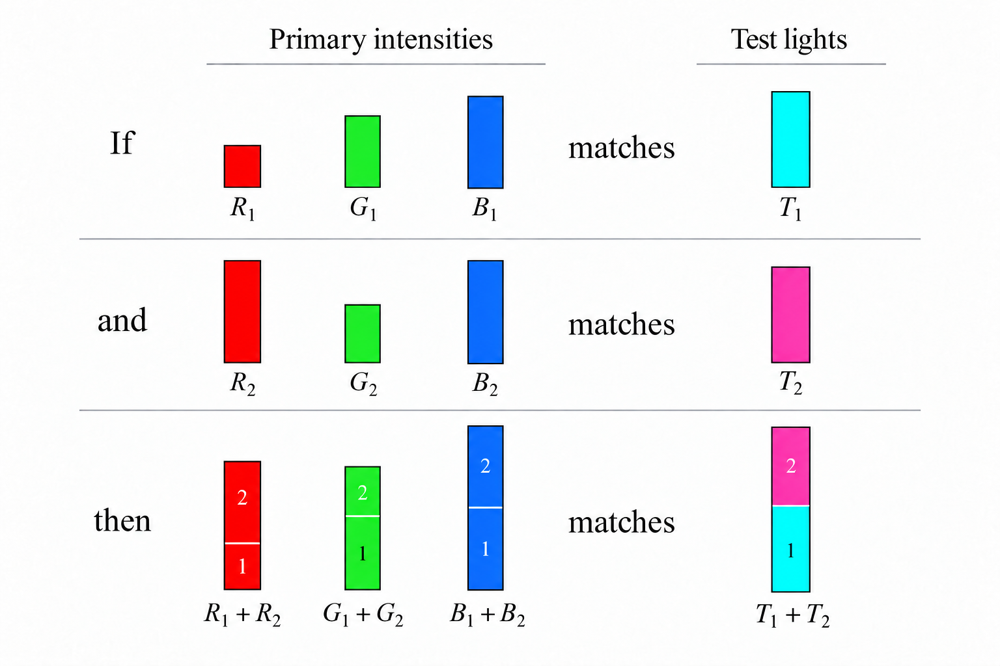{#fig-color-matching-additivity width=70%}

## Matrix formulation of color matching

The color matching experiment satisfies superposition. A psychological experiment that satisfies superposition is extremely rare; in fact, I am unaware of only one other impactful perceptual experiment that satisfies superposition (flicker photometry). When linearity is satisfied, we can characterize the system thoroughly.

In this case, we express the relationship between any test light and the primary intensities needed to match it using multidimensional linear algebra[^grassmann-history]. Suppose we represent a test light as a column vector, $\mathbf{t}$, whose entries $t[\lambda]$ specify the light's spectral power at sampled wavelengths $\lambda$. Because the system is linear, the primary intensities $(R, G, B)$ required for a match can be calculated by multiplying $\mathbf{t}$ by a $3 \times N$ matrix, $\mathbf{C}$:

[^grassmann-history]: Linear algebra was first invented by Grassman (@grassmann1995-newbranch) and applied to color science almost right away [@grassmann-1854]!

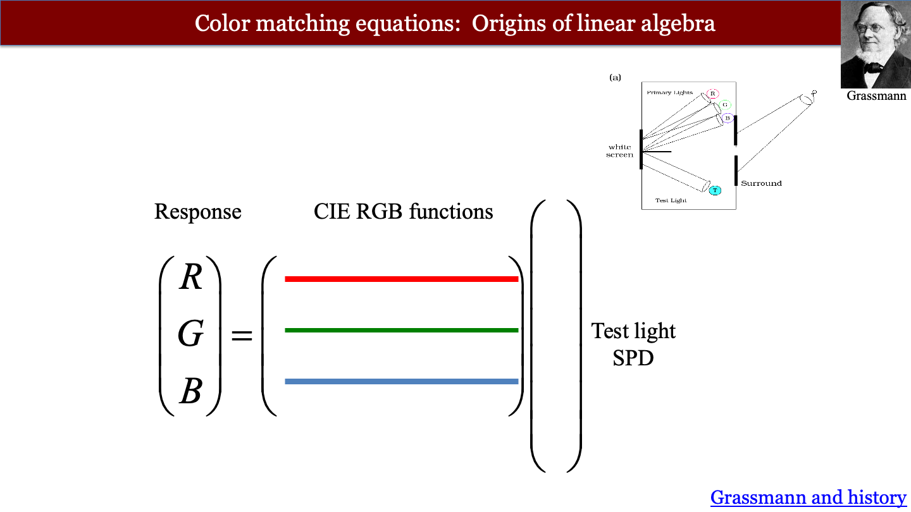{#fig-matching-tableau width="70%"}

We can write this as a very simple mathematical expression.

$$
\begin{pmatrix} R \\ G \\ B \end{pmatrix} = \mathbf{C} \mathbf{t}
$${#eq-color-match-matrix}

Thus equation shows how we can determine whether two lights have the same appearance. Two test lights, say $\mathbf{t}_1$ and $\mathbf{t}_2$ match in appearance if and only if the primary matching intensities computed from @eq-color-match-matrix are equal, 

$$
\mathbf{C} \mathbf{t}_1 = \mathbf{C} \mathbf{t}_2
$${#eq-color-match-metamers}

We call this pair of test lights *metamers*.  It is useful to note that the difference between two metamers satisfies

$$
\mathbf{0}  = \mathbf{C} {\mathbf{t}_2 - \mathbf{t}_1}
$${#eq-color-null-space}

In modern terms we say the difference between any pair of metamers is in the *null space* of the color matching functions.  The null space is one of many linear algebra concepts described first by Grassmann (@sec-grassmann-color).


### Dimensionality of the CMFs
How do we know that we should use three primary lights, and not two or four? 

If we provide people with just one or two primary lights, there will be many test lights that cannot be matched. That sets the minimum.  If we provide four primary lights, people set satisfactory matches with many different combinations of primary intensities. The match is not unique. With three primaries, a match can be set for every test light.

There is one detail, however.  In some cases, adding the three primaries together does not quite get there. To make a match we must add one (or even two) of the primaries into the test light side. In this case, we record its intensity as negative. Allowing for this caveat, a unique match can always be made with three primaries. That is why we say color-matching is three-dimensional.

You may have questions about the universality of this finding (color blindness, women with four cones, and just inter-observer variability).  All good questions.  More on this in @sec-human-color-metrics.
<!--
See the human-tetrachromacy.qmd file for more.
-->

### Measured CMF

How do we determine the entries of the matrix $\mathbf{C}$? Linear systems theory provides a straightforward answer: measure the system's response to impulse inputs. In optics, an impulse is a point of light, and the response is the point spread function (@sec-ls-point-matrix). In color matching, an impulse is a monochromatic (single-wavelength) test light.

Suppose the test light is a monochromatic light at wavelength $\lambda_k$ with unit power. Its spectral vector $\mathbf{t}$ contains zeros everywhere except for a value of 1 at entry $k$. When we multiply $\mathbf{C} \mathbf{t}$, this unit impulse simply extracts the $k^{\text{th}}$ column of $\mathbf{C}$ (@fig-matching-monochromatic). 

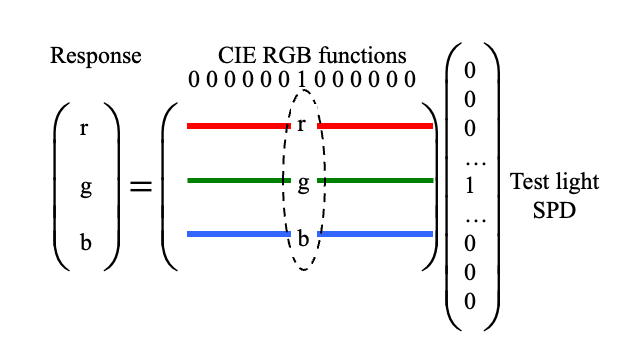{#fig-matching-monochromatic width="70%"}

By measuring the primary intensities needed to match monochromatic test lights across all sampled wavelengths of the visible spectrum, we directly measure every column of $\mathbf{C}$.

### Color matching functions

The rows of the measured matrix $\mathbf{C}$ are functions of wavelength, and they are conventionally written as $r(\lambda), g(\lambda), b(\lambda)$. Stiles and Burch directly measured RGB color-matching functions using monochromatic primaries (645.2 nm, 526.3 nm, and 444.4 nm) for both a 2-degree field [@stiles1955-he] and a 10-degree field [@stiles-colourmatching1959]. 


::: {#fig-sb-cmf-panel .figure}
::: {.panel-tabset}

### Stiles & Burch 10° (1959)
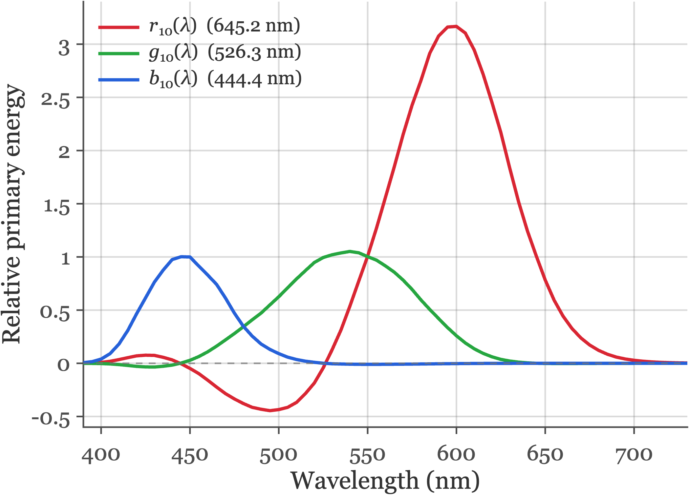{#fig-sb-1959-10deg width="72%"}

### Stiles & Burch 2° (1955)
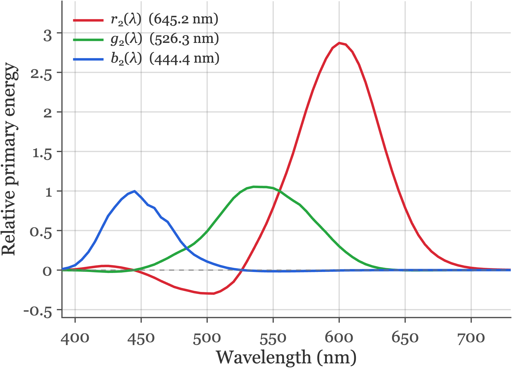{#fig-sb-1955-2deg width="72%"}

:::
Directly measured RGB color-matching functions for 10-degree and 2-degree bipartite fields using monochromatic primaries at 645.2 nm, 526.3 nm, and 444.4 nm. Source: `fise_cmfStilesBurch.m`.
:::

Human color matches depend slightly on the angular size of the bipartite stimulus field. Comparing the two tabs in @fig-sb-cmf-panel shows how field size alters the relative primary energies, particularly at short and middle wavelengths.

There are several reasons for this difference.  The central 2 degrees of the retina (the fovea) is covered by **macular pigment**, which absorbs short-wavelength (blue) light before it reaches the photoreceptors, and foveal cones have longer outer segments (higher photopigment optical density) than peripheral cones. For larger fields spanning 10 degrees, most of the stimulus falls outside the macula, increasing short-wavelength sensitivity and shifting the matches.

<!--
{#fig-rgb-cmfs width="80%"}
-->

::: {.callout-note title="Reading the CMF"}
When I teach, I often forget the wavelengths of the primary lights. But it is possible to deduce them from the graphs; can you see how? 

The principle is straightforward. When a monochromatic test light matches one of the primary lights, the primary intensities will be one of these three values: $(1,0,0)$, $(0,1,0)$, or $(0,0,1)$.  Read the curves to find the wavelengths at which the primaries have those values. You can get a close estimate.
:::

### Negative values in the CMF
A notable feature of these curves is that $r(\lambda)$ takes on negative values between approximately 480 nm and 530 nm. In this spectral region, monochromatic test lights appear more saturated in color than any additive mixture of the green and blue primaries can produce. To achieve a visual match, the experimenter adds some of the red primary to the *test light* side of the bipartite field, desaturating it until the remaining green and blue primaries can complete the match. Because color matching obeys superposition, adding primary light to the test field is mathematically equivalent to subtracting it from the primary side, resulting in negative coefficients in the color-matching functions.

This point matters in practice when we describe the colors a display can produce. A display has three primary lights, and there is no way to add a primary to the test side. Colors that would require negative primary values cannot be produced. This limitation defines the display *gamut* (@sec-display-principles-overview).

### Uniqueness of the CMFs
Two groups, A and B, who use different sets of primary lights, $\mathbf{P}_A$ and $\mathbf{P}_B$, will measure different CMFs. But the two sets of CMFs are related.

To see why, suppose group A measures the matches to the primaries of group B. Group A can then predict the matches that group B would set for any test light.

Represent the primaries as $N \times 3$ matrices, $\mathbf{P}_A$ and $\mathbf{P}_B$, whose columns are the spectral power distributions of the three primaries. Let $\mathbf{C}_A$ and $\mathbf{C}_B$ be the $3 \times N$ CMF matrices measured by the two groups. By definition, $(\mathbf{P}_B \mathbf{C}_B) \mathbf{t}$ is the spectral power distribution of group B's primaries that matches $\mathbf{t}$. That light must be metameric to $t$. So 

$$
\mathbf{C}_A \mathbf{t} = \mathbf{C}_A (\mathbf{P}_B \mathbf{C}_B) \mathbf{t}.
$$

The $3 \times 3$ matrix $\mathbf{M}_{B,A} = \mathbf{C}_A \mathbf{P}_B$ converts group B primary values into group A primary values. Because this holds for every test light $\mathbf{t}$,

$$
\mathbf{C}_A = \mathbf{M}_{B,A} \, \mathbf{C}_B .
$$ {#eq-cmf-conversion}

The converse also holds. Multiply both sides of @eq-color-match-metamers by any invertible $3 \times 3$ matrix, $\mathbf{A}$. The predicted matches are unchanged:

$$
\mathbf{A} \mathbf{C} \mathbf{t}_1 = \mathbf{A} \mathbf{C} \mathbf{t}_2 \quad \Longleftrightarrow \quad \mathbf{C} \mathbf{t}_1 = \mathbf{C} \mathbf{t}_2 .
$$ {#eq-uniqueness-1}

In words: *Any pair of CMFs is related by a $3 \times 3$ linear transformation.*

As a practical matter this means we do not need to use the measured CMFs. Instead, we can use any linear transformation of the measured functions we like. 

::: {.callout-note title="Color matching, biology, and psychology" collapse="true"}

### Color matching and biology
The search for the biological substrate of color-matching is a very inspiring story that I cover in [Foundations of Vision](https://wandell.github.io/FOV-1995/chapter-4-wavelength-encoding.html#the-biological-basis-of-photopic-color-matching){target=_blank}.  The story spans Newton's analysis of light, Young and Maxwell's color-matching, the identification of the cone photoreceptors, and finally the quantification of the cone photoreceptor responses. This story is the most thorough understanding neuroscientists have of a perceptual phenomenon.

Let's not leave the implications for psychology out of the story. After his work on color-matching, Maxwell wrote that it is possible to create a quantitative science of consciousness based on perceptual observations. 

> If the sensation which we call colour has any laws, it must be in our own nature which determines the form of these laws; and I need not tell you that the only evidence we can obtain respecting ourselves is derived from consciousness.
>
> The science of colour must therefore be regarded as essentially a mental science. It differs from the greater part of what is called mental science in the large use which it makes of the physical sciences, and in particular of optics and anatomy. But it gives evidence that it is a mental science by the numerous illustrations which it furnishes of various operations of the mind [@maxwell1872-colorvision].

Creating a quantitative mental science is not easy. But if we mean to understand ourselves, and improve ourselves, it seems like a wonderful scientific topic.
:::

## CIE Standards {#sec-cie-standards}

Standards bodies exploit this linear-transformation freedom (@eq-uniqueness-1) to define shared reference observers for science and industry. Rather than tabulating CMFs tied to a particular laboratory's RGB primaries—which inevitably have negative lobes—the Commission Internationale de l'Éclairage (CIE) applies an invertible $3 \times 3$ transformation to measured RGB matches so that the resulting color-matching functions are non-negative everywhere and the middle function equals the photopic luminous efficiency function $V(\lambda)$.

### CIE XYZ and physiologically based cone standards

ISETCam includes three generations of [CIE color standards](https://github.com/ISET/isetcam/blob/main/data/human/README.md).  You can compare them in @fig-cie-standards-panel:

1. **CIE 1931 2-degree XYZ ($\bar{x}, \bar{y}, \bar{z}$):** The original standard observer, reconstructed from the 2-degree chromaticity measurements of Wright and Guild combined with the CIE 1924 photopic luminosity function $V(\lambda)$ [@wyszeckicolorscienceconcepts1982].
2. **CIE 1964 10-degree XYZ ($\bar{x}_{10}, \bar{y}_{10}, \bar{z}_{10}$):** The large-field standard observer, derived by linearly transforming the 10-degree RGB color-matching functions of Stiles and Burch [@stiles-colourmatching1959] (with a small weight given to the measurements of Speranskaya, 1959).
3. **Judd–Vos revisions and CIE 2006 / 2012 physiological standards:** The CIE 1924 $V(\lambda)$ function—and therefore the CIE 1931 XYZ standard—substantially underestimated human sensitivity at short wavelengths (below 460 nm). Judd [@judd1951b-artificialdaylight] and later Vos (1978) introduced modified 2-degree observers to correct this short-wavelength error. Building on the Stiles and Burch color matches and spectral sensitivity measurements in observers of known photopigment genotype, Stockman and Sharpe [@stockmanSpectralSensitivitiesMiddle2000; @stockmanConeFundamentalsCIE2019] derived the 2-degree and 10-degree L-, M-, and S-cone spectral sensitivities. The CIE adopted these curves as the **CIE 2006 cone fundamentals** [@cieFundamentalChromaticityDiagram2007] and defined a corresponding linear transformation—the **CIE 2012 (2015) physiologically based XYZ** functions ($\bar{x}_{\mathrm{F}}, \bar{y}_{\mathrm{F}}, \bar{z}_{\mathrm{F}}$)—that reconciles tristimulus colorimetry directly with human cone excitations.

::: {#fig-cie-standards-panel .figure}
::: {.panel-tabset}

### CIE 1931 XYZ (2°)
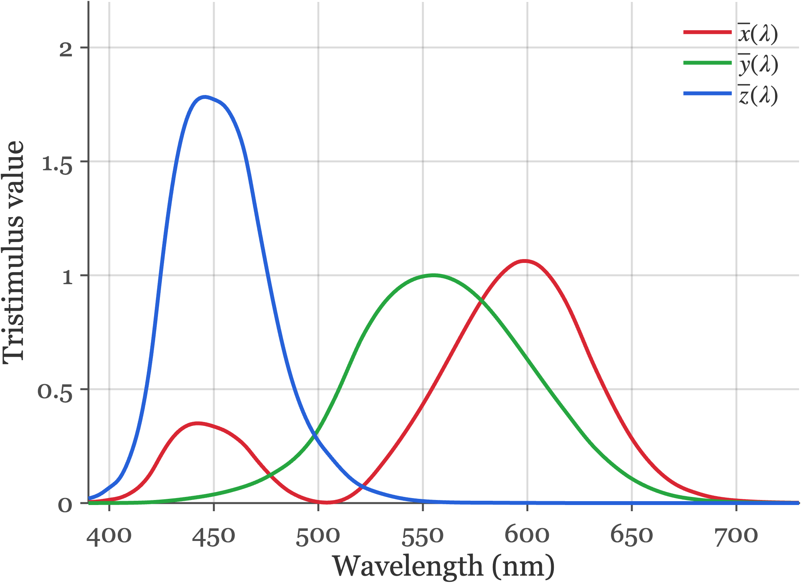{#fig-XYZ-1931 width="72%"}

### CIE 1964 XYZ (10°)
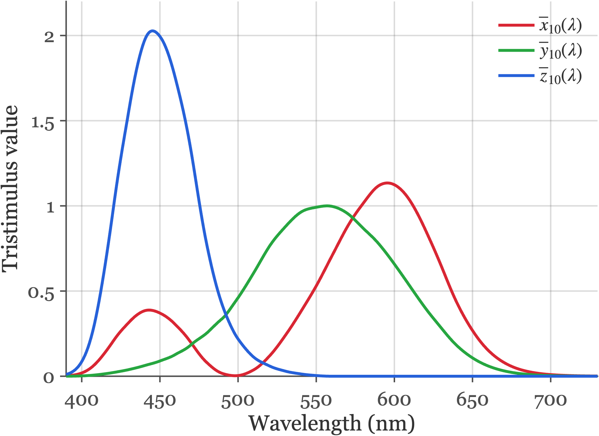{#fig-XYZ-1964 width="72%"}

### CIE 2012 XYZ (2°)
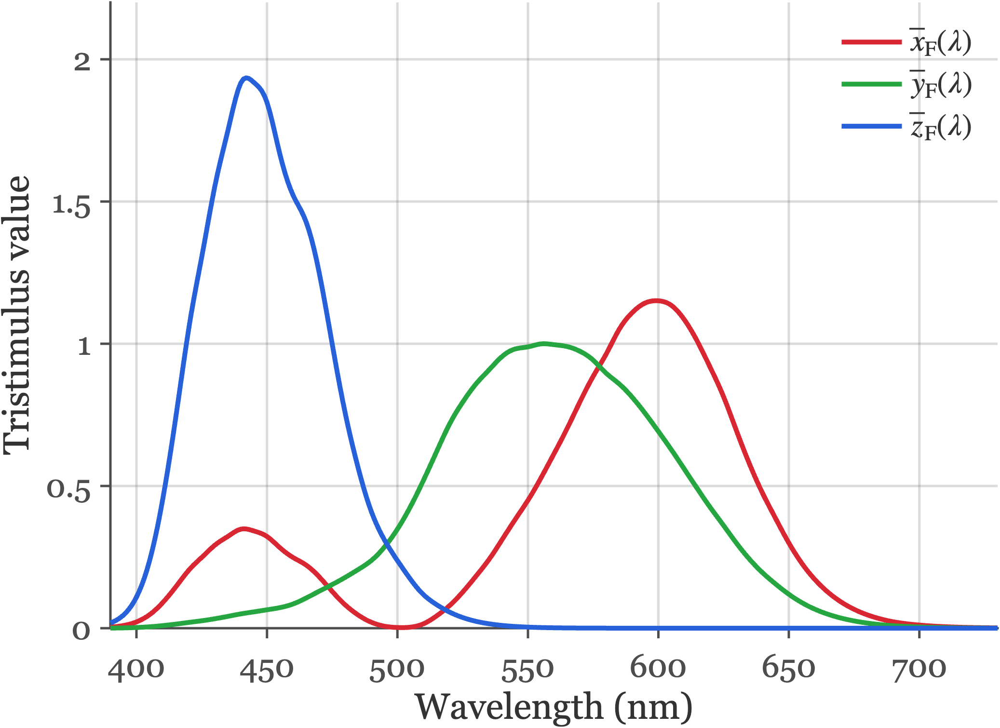{#fig-XYZ-2012 width="72%"}

### CIE 2006 Cones (2°)
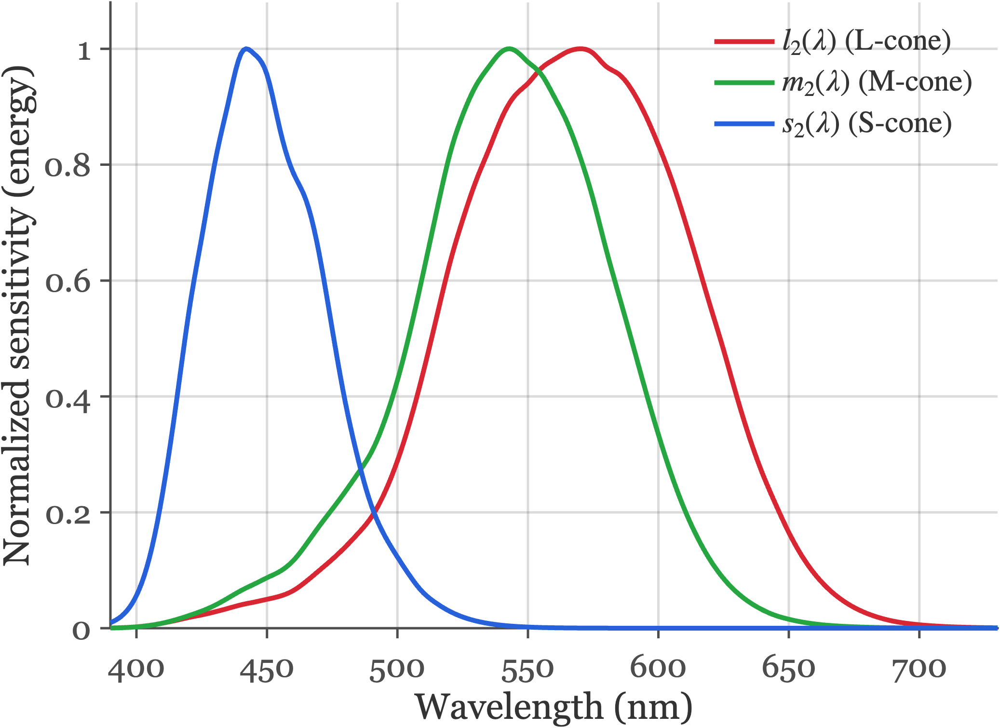{#fig-cones-2006-2deg width="72%"}

### CIE 2006 Cones (10°)
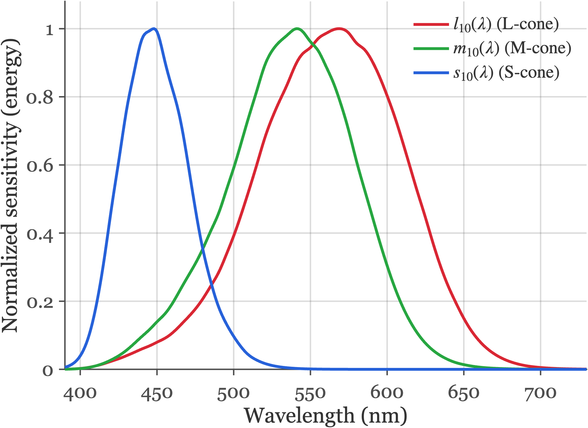{#fig-cones-2006-10deg width="72%"}

:::
CIE standard color-matching functions and physiologically based cone fundamentals (energy basis). Source: `fise_cieStandards.m`.
:::

It was a great pleasure to discover that Maxwell's measurements are extremely close to the modern standards! 

{#fig-maxwell-cmf-modern width="70%"}

## Display primary intensities {#sec-display-color-matching}

The facts of color-matching are why we can make visual displays that create color images that appear to be the same as a natural scene without reproducing the original spectral data. We present the viewers with metamers to the original data. This was Maxwell's original insight.  Measure a light, calculate how it would be matched by three primaries, and then build an image that has the right amounts of each of the three primaries.

All of our visual displays work on this principle.  The mathematics of the idea is straightforward, and in this section I will introduce the key ideas using a classic - and now largely abandoned - display technology, the cathode ray tube (CRT).

Explain the CRT here.  Emphasize that each pixel is like a little color-matching experiment.

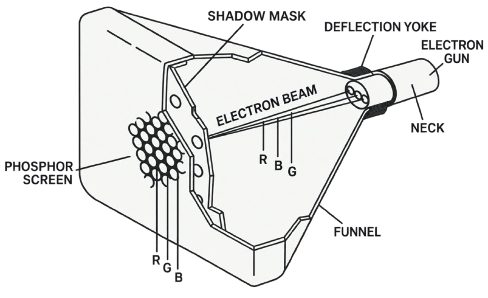{#fig-crt-display width=60%}

Think of the pixel as comprising three primary lights.

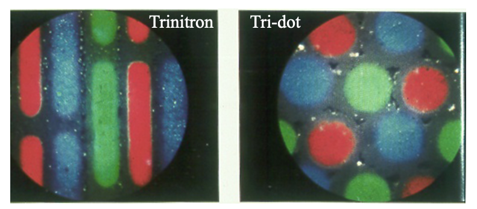{#fig-crt-pixel width="60%"}

The possible spectra from each pixel in the display is always the weighted sum of the three display primaries. The linearity of the superposition of incoherent light sources is what we show in this image.

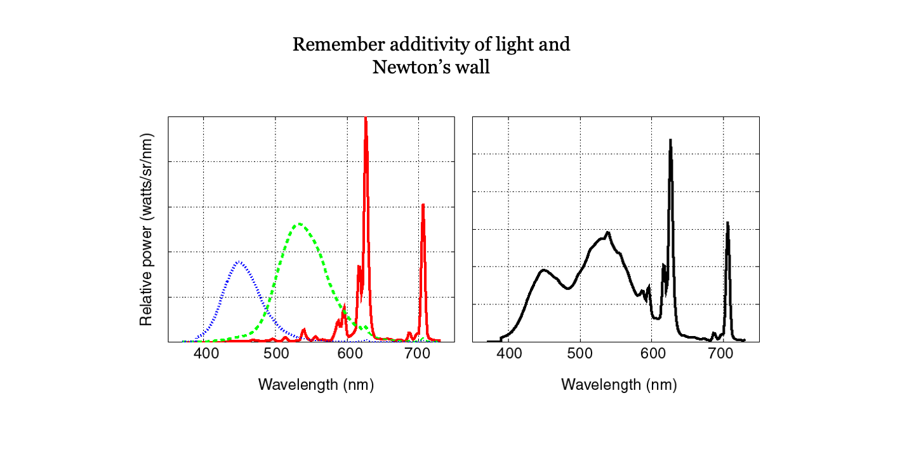

We can express that, as we have above, using this matrix tableau.

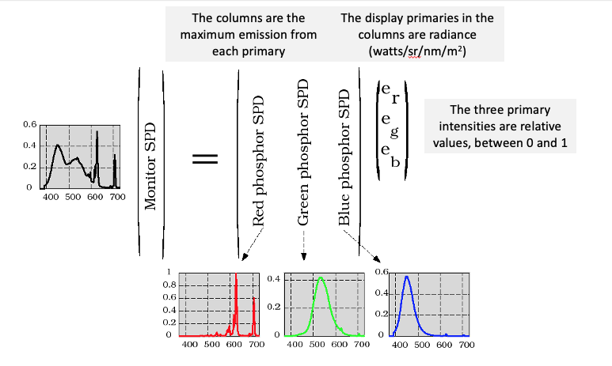{#fig-crt-matrix width="70%"}

Without explaining how, we imagine that the signal captured by the camera is used to estimate the XYZ value at each pixel.  That is the information sent to the display.

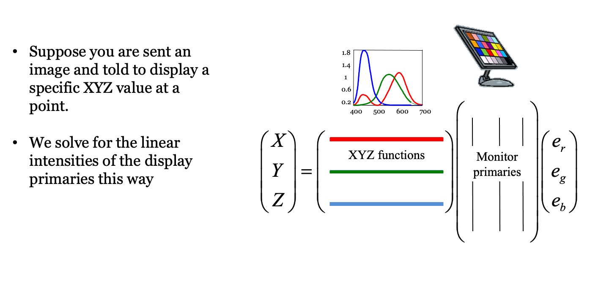{#fig-xyz-primaries width="70%"}

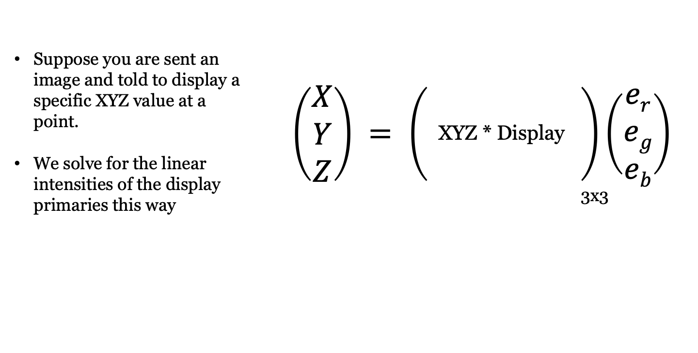{#fig-xyz-primary-equation width="70%"}

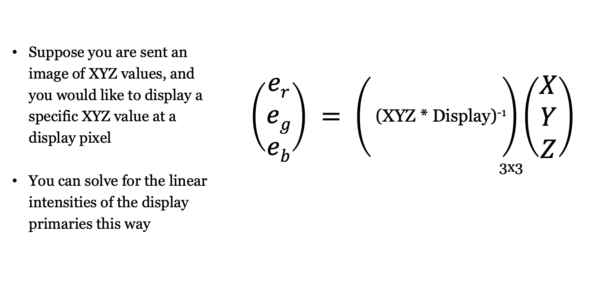{#fig-xyz-primaries-inverse width="70%"}

Suppose a display has three primaries whose spectral power distributions form the columns of an $N \times 3$ matrix $\mathbf{P} = [\mathbf{p}_1, \mathbf{p}_2, \mathbf{p}_3]$. 

When the primaries are driven with relative weights $\mathbf{w} = (w_1, w_2, w_3)^T$, the emitted light has spectral power distribution $\mathbf{P}\mathbf{w}$. For the displayed light to match the target light $\mathbf{t}$ in appearance, their tristimulus values under the color-matching matrix $\mathbf{C}$ (such as the CIE $\mathbf{XYZ}$ functions) must be equal:

$$
\mathbf{C}\mathbf{t} = \mathbf{C}(\mathbf{P}\mathbf{w}) = (\mathbf{C}\mathbf{P})\mathbf{w} .
$$ {#eq-display-primary-match}

Because $\mathbf{C}\mathbf{P}$ is a $3 \times 3$ matrix whose columns are simply the tristimulus values of the three display primaries, we can solve for the required display primary weights directly:

$$
\mathbf{w} = (\mathbf{C}\mathbf{P})^{-1}\mathbf{C}\mathbf{t} .
$$ {#eq-display-primary-weights}

Physical displays can only emit non-negative amounts of light ($w_i \ge 0$) up to each primary's maximum intensity ($w_i \le 1$). Target lights $\mathbf{t}$ for which the solution $\mathbf{w}$ contains negative entries or entries greater than 1 lie outside the display's **color gamut**.

In the next chapter (@sec-human-color-metrics), we extend these tristimulus coordinates to chromaticity diagrams, perceptual color difference metrics (CIELAB), and spatial-color metrics (S-CIELAB). In Part V (@sec-display-principles), we combine this linear primary calculation with display gamma curves and subpixel point spread functions to form the complete Standard Display Model.

