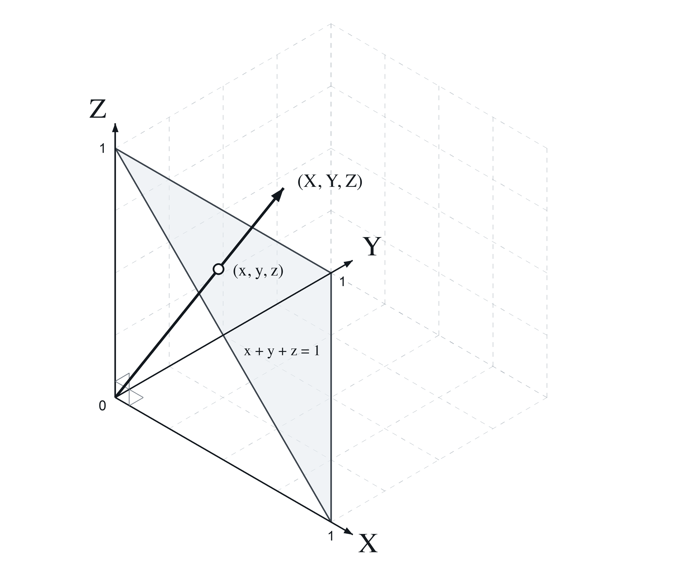
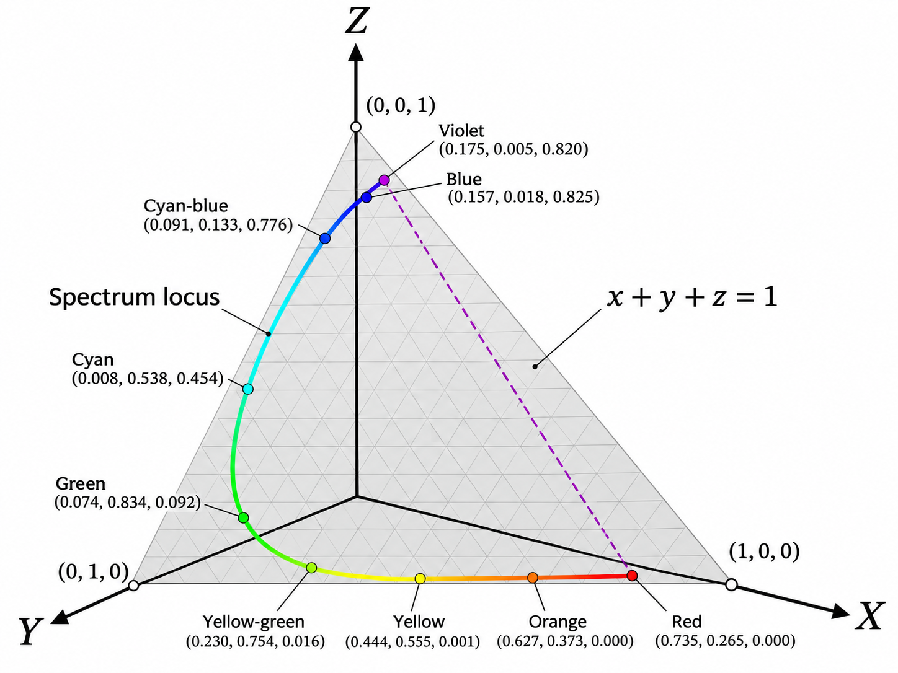
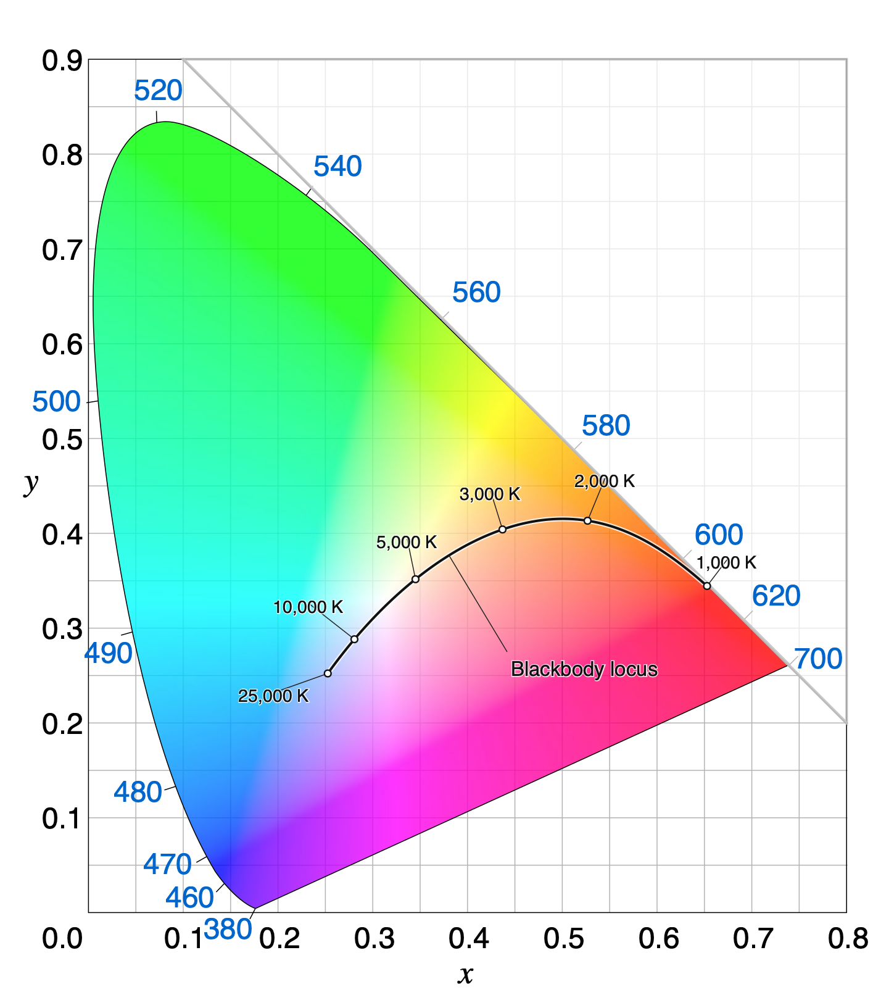
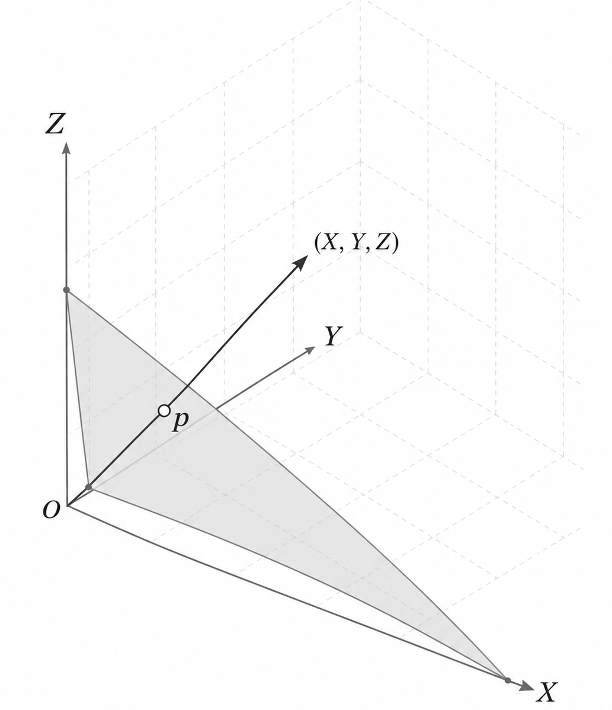

# Color representations and metrics {#sec-human-color-metrics}



## Color representations and metrics overview {#sec-human-color-metrics-overview}

@sec-human-wavelength-encoding introduced the color-matching functions and the CIE $\mathbf{XYZ}$ standard observer. The CMFs enable us to determine when two spectral power distributions match in appearance, and how a $3 \times 3$ matrix calculation determines the display primary intensities needed to reproduce a target light.

However, color matching only tells us whether two lights look *identical* ($\mathbf{C}\mathbf{t}_1 = \mathbf{C}\mathbf{t}_2$). But it misses two important facts.  First, the CMF calculation doesn't tell us what the light looks like; is it red, yellow, blue?  Second, when two lights do not match precisely the CMF calculation doesn't tell us how large the perceptual difference will appear.  These are important questions for image systems engineers.

This chapter introduces the tools used by engineers to visualize color gamuts and quantify visible color differences:

1. **Chromaticity coordinates** for separating relative spectral composition from overall intensity and visualizing display gamuts in two dimensions.
2. **CIELAB ($\Delta E_{ab}^*$)** for transforming linear tristimulus values into an approximately perceptually uniform space to measure large-field color differences.
3. **Spatial-CIELAB (S-CIELAB)** for combining the spatial contrast sensitivity functions (@sec-human-spatial-metrics) with CIELAB to predict the visibility of spatial-chromatic patterns such as halftones, color filter array artifacts, and display subpixels.

## Chromaticity coordinates {#sec-chromaticity-coordinates}

When we describe the appearance of a light, it is natural to separate its overall brightness from its hue and saturation. How can we convert the three-dimensional CIE tristimulus values, $(X, Y, Z)$, into a two-dimensional representation that isolates relative spectral composition from intensity?

**Chromaticity coordinates (xy)** are the oldest and most widely used approach. If we normalize each tristimulus coordinate by the sum $X + Y + Z$, scaling the intensity of a light by a positive factor cancels out in the ratio. Because the three normalized coordinates sum to one, only two of them—conventionally $(x, y)$—are independent:

$$
\begin{aligned}
x &= \frac{X}{X + Y + Z}, \qquad y = \frac{Y}{X + Y + Z}, \\[6pt]
z &= \frac{Z}{X + Y + Z} = 1 - x - y .
\end{aligned}
$$ {#eq-chromaticity}

We can visualize the geometry of this mapping in two steps (@fig-chromaticity-projection). First, for any tristimulus vector $(X, Y, Z)$, the normalized vector $(x, y, z)$ lies at the intersection of the ray from the origin through $(X, Y, Z)$ and the unit plane $x + y + z = 1$ (the shaded gray triangle in @fig-cie-chromaticity). Second, tracing the rays for monochromatic lights across the visible spectrum sweeps out a horseshoe-shaped curve on that unit plane called the **spectrum locus** (@fig-chromaticity-geometry). Projecting the unit plane orthographically onto the $(x, y)$ axes produces the standard two-dimensional **CIE $(x, y)$ chromaticity diagram** (@fig-chromaticity-appearance).

::: {#fig-chromaticity-projection layout-ncol=2}
{#fig-cie-chromaticity}

{#fig-chromaticity-geometry}

Geometric construction of the CIE chromaticity coordinates on the plane $x + y + z = 1$ before orthographic projection onto the $(x, y)$ plane.
:::

The spectrum locus is fundamental because it forms the outer boundary of the chromaticity coordinates for all physical lights. This property follows directly from a geometric rule of chromaticity diagrams: the chromaticity of an additive mixture of two lights always lies on the straight line segment connecting their individual chromaticities (see @nte-chromaticity-mixture). Because every physical light is a non-negative mixture of spectral lights, the chromaticity of any real light must lie inside the convex hull of the spectrum locus, bounded below by the straight "line of purples" connecting the short- and long-wavelength ends of the spectrum.

::: {.callout-note title="Chromaticity of the mixture of two lights" collapse="true" #nte-chromaticity-mixture}
The chromaticity coordinate of an additive mixture of two lights lies on the straight line segment connecting their chromaticities.

Suppose Light 1 and Light 2 have CIE tristimulus vectors $\mathbf{C}_1 = (X_1, Y_1, Z_1)$ and $\mathbf{C}_2 = (X_2, Y_2, Z_2)$, with coordinate sums

$$
S_1 = X_1 + Y_1 + Z_1 \quad \text{and} \quad S_2 = X_2 + Y_2 + Z_2 .
$$

From @eq-chromaticity, the 2D chromaticity coordinates $\mathbf{c}_1 = (x_1, y_1)$ and $\mathbf{c}_2 = (x_2, y_2)$ satisfy

$$
(X_1, Y_1) = S_1 (x_1, y_1) \quad \text{and} \quad (X_2, Y_2) = S_2 (x_2, y_2) .
$$

By superposition, mixing the two lights sums their tristimulus vectors:

$$
\mathbf{C}_3 = (X_1 + X_2, \; Y_1 + Y_2, \; Z_1 + Z_2) .
$$

The coordinate sum of the mixture is $S_3 = S_1 + S_2$, so the chromaticity of the mixture $\mathbf{c}_3 = (x_3, y_3)$ is

$$
\begin{aligned}
x_3 &= \frac{X_1 + X_2}{S_1 + S_2} = \frac{S_1 x_1 + S_2 x_2}{S_1 + S_2} = \left(\frac{S_1}{S_1 + S_2}\right) x_1 + \left(\frac{S_2}{S_1 + S_2}\right) x_2 , \\
y_3 &= \frac{Y_1 + Y_2}{S_1 + S_2} = \frac{S_1 y_1 + S_2 y_2}{S_1 + S_2} = \left(\frac{S_1}{S_1 + S_2}\right) y_1 + \left(\frac{S_2}{S_1 + S_2}\right) y_2 .
\end{aligned}
$$

Defining $\alpha = \frac{S_1}{S_1 + S_2}$, we see that $1 - \alpha = \frac{S_2}{S_1 + S_2}$, with $0 < \alpha < 1$ whenever $S_1, S_2 > 0$. In vector form, the chromaticity of the mixture is a convex combination of $\mathbf{c}_1$ and $\mathbf{c}_2$:

$$
\mathbf{c}_3 = \alpha \mathbf{c}_1 + (1 - \alpha) \mathbf{c}_2 .
$$

As the relative intensities of the two lights vary, $\mathbf{c}_3$ sweeps out the line segment connecting $\mathbf{c}_1$ and $\mathbf{c}_2$ in the $(x, y)$ chromaticity diagram.
:::

### Commonly used features of the chromaticity diagram

Several classic colorimetric concepts and engineering tools are described on the chromaticity diagram:

**Blackbody (Planckian) locus** As the temperature of a blackbody radiator increases from $2000\text{ K}$ to $9000\text{ K}$, its spectral power distribution shifts toward shorter wavelengths, tracing a smooth arc from orange-red through neutral white to bluish-white near the center of the chromaticity diagram (@fig-chromaticity-appearance).

The approximate color appearance across the CIE 1931 $(x, y)$ chromaticity diagram is illustrated schematically in @fig-chromaticity-appearance. White and neutral grays fall near the center of the diagram—where the blackbody locus traces the chromaticities of thermal radiators across color temperatures—while saturated spectral hues lie along the outer boundary.

{#fig-chromaticity-appearance width="50%"}

**Complementary wavelengths** are defined as a pair of monochromatic lights whose additive mixture can match a chosen reference white (such as CIE D65). (@fig-chromaticity-complementary). **Dominant wavelength** is defined by a ray from the reference white point through a test light's chromaticity out to the spectrum locus (@fig-chromaticity-dominant). The fractional distance along the segment from white to the boundary quantifies the excitation **purity**. 

::: {#fig-chromaticity-complementary-dominant layout-ncol=2}
{#fig-chromaticity-complementary}

{#fig-chromaticity-dominant}

Complementary wavelengths and dominant wavelength constructions on the CIE $(x, y)$ chromaticity diagram.
:::

### Display chromaticity gamuts {#sec-chromaticity-gamuts}

One of the most common and practical uses of chromaticity coordinates is to visualize the range of colors a display can produce (@sec-display-color-matching). The two-dimensional chromaticity gamut follows directly from the two-light mixture rule (@nte-chromaticity-mixture): any non-negative additive combination of three primary lights ($R$, $G$, and $B$) lies inside the **triangle** whose vertices are the chromaticities of the three primaries (@fig-chromaticity-gamut).

::: {#fig-chromaticity-gamuts-panel .figure}
::: {.panel-tabset}

### Display primary triangle
{#fig-chromaticity-gamut width="75%"}

### Display gamut vs. human vision
{#fig-chromaticity-multiple-gamuts width="75%"}

:::
Visualizing display color reproduction limits as triangles in the CIE $(x, y)$ chromaticity diagram.
:::

Any chromaticity inside the triangle can be reproduced by the display; any chromaticity outside the triangle would require a negative weight on at least one primary (@eq-display-primary-weights) and is out of gamut. Keep two caveats in mind when interpreting these chromaticity triangles:

1. **Chromaticity omits luminance.** The $(x, y)$ triangle is a two-dimensional projection of the three-dimensional color solid swept out over the valid range of primary intensities. The projection does not show how the range of achievable chromaticities shrinks near the display's peak luminance (where primaries saturate) or near its black level (where ambient flare and dark light dominate).
2. **Displays have primary gamuts; sensors do not.** While a three-primary display is physically restricted to the convex triangle of its emitters (@fig-chromaticity-multiple-gamuts), a camera sensor does not emit primaries—it is designed to respond to light across the visible spectrum. People sometimes use the phrase "sensor gamut," which has never seemed like a good idea to me. The meaningful engineering question for a sensor is how accurately its responses can be transformed into the human visual encoding—a topic we return to later.

## Representing perceptual differences {#sec-perceptual-differences}

The $(x, y)$ chromaticity coordinates are simple to compute: we normalize by the coordinate sum $X + Y + Z$, which geometrically corresponds to intersecting each ray from the origin with the plane $X + Y + Z = 1$. However, the $(x, y)$ diagram has an important practical shortcoming: equal distances on the chart do not correspond to equal perceptual differences. A large upper region of the $(x, y)$ diagram appears green with relatively little change in perceived hue across long distances, whereas in the blue and purple regions a small step produces a large change in color appearance (@fig-chromaticity-appearance).

For engineering applications, it is often useful to have a representation such that equal numerical distances correspond to roughly equal perceptual differences. Several colorimetric standards have been developed toward this goal.

### $(u', v')$ chromaticity coordinates {#sec-uv-chromaticity}

The **CIE 1976 $(u', v')$ Uniform Chromaticity Scale (UCS)** diagram, an influential alternative to $(x, y)$, which rescales the chromaticity plane so that perceptual differences are spaced much more evenly across hues.  The formula for $u'$ and $v'$ is

$$
u' = \frac{4X}{X + 15Y + 3Z}, \qquad v' = \frac{9Y}{X + 15Y + 3Z} .
$$ {#eq-uv-chromaticity}

*(In the earlier CIE 1960 UCS definition, $u = u'$ and $v = \frac{2}{3}v' = \frac{6Y}{X + 15Y + 3Z}$.)*

Like the $(x, y)$ transformation, @eq-uv-chromaticity is a projective mapping: scaling a tristimulus vector by any positive constant $k$, so that $(X, Y, Z) \mapsto k(X, Y, Z)$, produces the exact same $(u', v')$ coordinate. Geometrically, each ray from the origin intersects the tilted plane $X + 15Y + 3Z = 1$ in tristimulus space, and the intersection is projected onto the $(u', v')$ plane with axis scale factors of $4$ and $9$ (@fig-uv-projection). Because this mapping is still a central projection onto a plane, additive mixtures of lights continue to lie on straight line segments, and display gamuts remain triangles.

::: {#fig-uv-projection layout-ncol=2}
{#fig-uv-plane}

, public domain).](images/human/06-color-metrics/chromaticity/CIE_1976_UCS-wikipedia-blackbody.png){#fig-uv-blackbody-geometry}

Geometric construction of the CIE 1976 $(u', v')$ chromaticity coordinates via the plane $X + 15Y + 3Z = 1$ (left) and the resulting $(u', v')$ Uniform Chromaticity Scale diagram (right).
:::

Both chromaticity representations discard luminance, and thus it is common to inform users about luminance using just the $Y$ value.  Thus, $Yxy$ and $Yu'v'$ are commonly reported.  It is possible to invert those three values to recover the $(X,Y,Z)$ values.

The $(u', v')$ improves the uniformity of two-dimensional chromaticity spacing, but it is far from perfect.   To quantify the full perceptual difference between two colors that may differ in both luminance and chromaticity, we need a three-dimensional space that incorporates adaptation to the scene white point and the nonlinear brightness sensitivity of human vision.

## CIELAB {#sec-cielab}

<!-- TODO: Explain why Euclidean distance in CIE XYZ or (x,y) is not perceptually uniform (MacAdam ellipses).
Introduce opponent-color organization, adaptation to the white point (X_n, Y_n, Z_n), the cube-root compressive nonlinearity, L*, a*, b* coordinates, and Delta E.
Reference Bob Hunt and Mark Fairchild contributions. -->

## Spatial-CIELAB (S-CIELAB) {#sec-scielab}

<!-- TODO: Explain why CIELAB alone is insufficient for patterned images (depends on viewing distance and spatial frequency).
Show the S-CIELAB architecture (Zhang & Wandell, 1997):
1. Transform image into opponent-color channels (luminance, red-green, blue-yellow).
2. Filter each channel by its corresponding spatial Contrast Sensitivity Function (CSF) scaled for viewing distance (cycles per degree).
3. Transform the filtered representation back to CIE XYZ and compute point-by-point CIELAB Delta E.
Bridge forward to Part V (Displays), where CIELAB and S-CIELAB are used to evaluate display bit-depth and subpixel rendering (@sec-display-principles). -->

