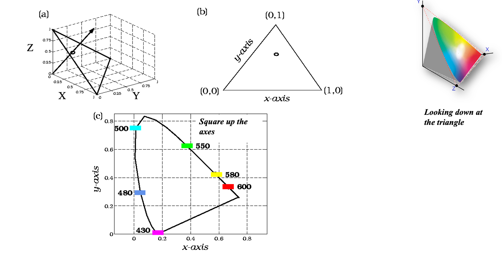
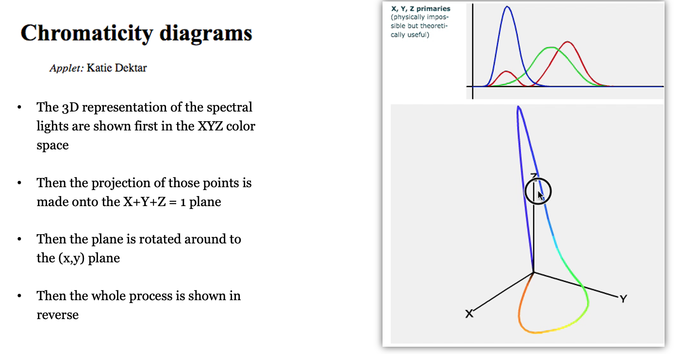
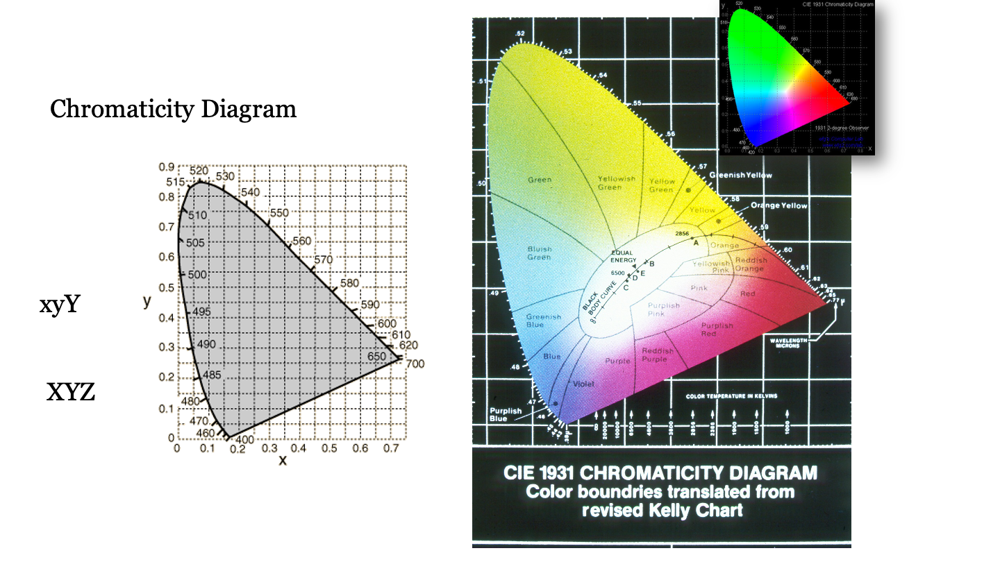
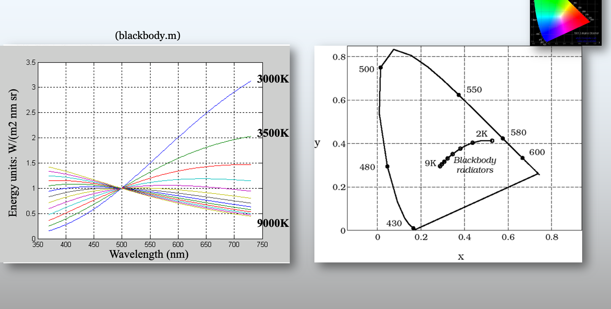
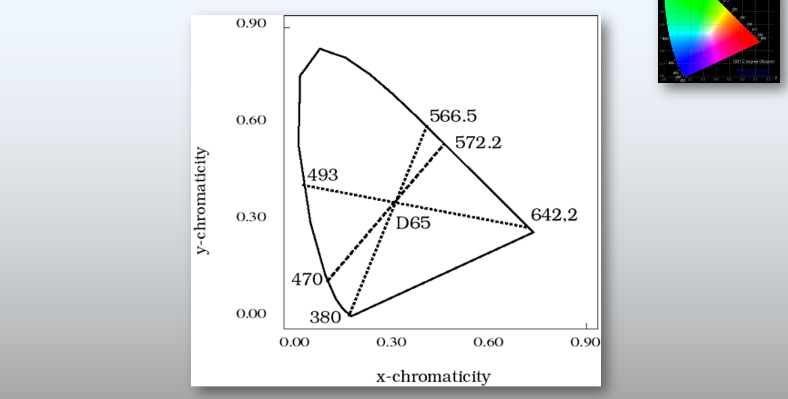
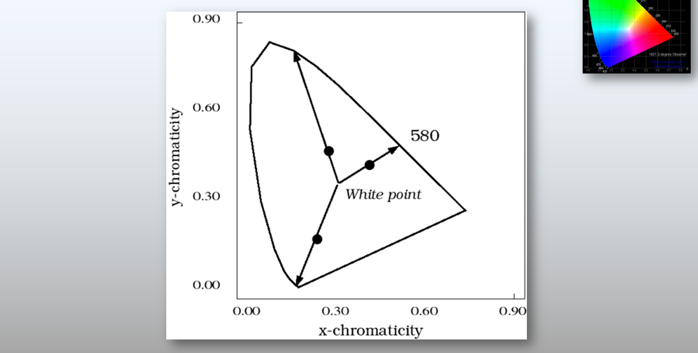
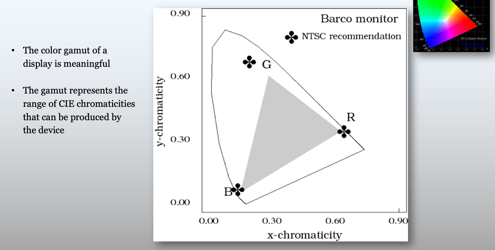
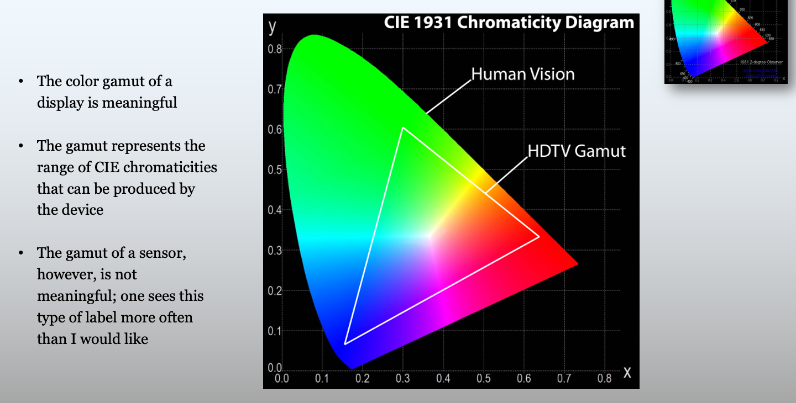

# Color representations and metrics {#sec-human-color-metrics}



## Color metrics overview {#sec-human-color-metrics-overview}

@sec-human-wavelength-encoding introduced the color-matching functions and the CIE $\mathbf{XYZ}$ standard observer. The CMFs enable us to determine when two spectral power distributions match in appearance, and how a $3 \times 3$ matrix calculation determines the display primary intensities needed to reproduce a target light.

However, color matching only tells us whether two lights look *identical* ($\mathbf{C}\mathbf{t}_1 = \mathbf{C}\mathbf{t}_2$). But it misses two important facts.  First, the CMF calculation doesn't tell us what the light looks like; is it red, yellow, blue?  Second, when two lights do not match precisely the CMF calculation doesn't tell us how large the perceptual difference will appear.  These are important questions for image systems engineers.

This chapter introduces the tools used by engineers to visualize color gamuts and quantify visible color differences:

1. **Chromaticity coordinates** for separating relative spectral composition from overall intensity and visualizing display gamuts in two dimensions.
2. **CIELAB ($\Delta E_{ab}^*$)** for transforming linear tristimulus values into an approximately perceptually uniform space to measure large-field color differences.
3. **Spatial-CIELAB (S-CIELAB)** for combining the spatial contrast sensitivity functions (@sec-human-spatial-metrics) with CIELAB to predict the visibility of spatial-chromatic patterns such as halftones, color filter array artifacts, and display subpixels.

## Chromaticity coordinates {#sec-chromaticity-coordinates}

Introduce CIE (x, y) chromaticity coordinates: 

$$
 x = X / (X + Y + Z), ~ y = Y / (X + Y + Z), ~ z = Z/(X + Y+Z)
$$

Notice that by definition $1 = x + y + z$.

Show the spectrum locus, convex combinations of additive mixtures, and the triangle of display primaries defining the display gamut.

{#fig-chromaticity-construction width="60%"}

{#fig-chromaticity-geometry width="60%"}

{#fig-chromaticity-diagram width="60%"}

{#fig-chromaticity-blackbody width="60%"}

{#fig-chromaticity-complementary width="60%"}

{#fig-chromaticity-dominant width="60%"}

{#fig-chromaticity-gamut width="60%"}

{#fig-chromaticity-multiple-gamuts width="60%"}

## Perceptual uniformity and CIELAB {#sec-cielab}

<!-- TODO: Explain why Euclidean distance in CIE XYZ or (x,y) is not perceptually uniform (MacAdam ellipses).
Introduce opponent-color organization, adaptation to the white point (X_n, Y_n, Z_n), the cube-root compressive nonlinearity, L*, a*, b* coordinates, and Delta E.
Reference Bob Hunt and Mark Fairchild contributions. -->

## Spatial-CIELAB (S-CIELAB) {#sec-scielab}

<!-- TODO: Explain why CIELAB alone is insufficient for patterned images (depends on viewing distance and spatial frequency).
Show the S-CIELAB architecture (Zhang & Wandell, 1997):
1. Transform image into opponent-color channels (luminance, red-green, blue-yellow).
2. Filter each channel by its corresponding spatial Contrast Sensitivity Function (CSF) scaled for viewing distance (cycles per degree).
3. Transform the filtered representation back to CIE XYZ and compute point-by-point CIELAB Delta E.
Bridge forward to Part V (Displays), where CIELAB and S-CIELAB are used to evaluate display bit-depth and subpixel rendering (@sec-display-principles). -->

