# Color representations and metrics {#sec-human-color-metrics}



## Color representations and metrics overview {#sec-human-color-metrics-overview}

@sec-human-wavelength-encoding introduced the color-matching functions and the CIE $\mathbf{XYZ}$ standard observer. The CMFs enable us to determine when two spectral power distributions match in appearance, and how a $3 \times 3$ matrix calculation determines the display primary intensities needed to reproduce a target light.

However, color matching only tells us whether two lights look *identical* ($\mathbf{C}\mathbf{t}_1 = \mathbf{C}\mathbf{t}_2$). But it misses two important facts.  First, the CMF calculation doesn't tell us what the light looks like; is it red, yellow, blue?  Second, when two lights do not match precisely the CMF calculation doesn't tell us how large the perceptual difference will appear.  These are important questions for image systems engineers.

This chapter introduces the tools used by engineers to visualize color gamuts and quantify visible color differences:

1. **Chromaticity coordinates** for separating relative spectral composition from overall intensity and visualizing display gamuts in two dimensions.
2. **CIELAB ($\Delta E_{ab}^*$)** for transforming linear tristimulus values into an approximately perceptually uniform space to measure large-field color differences.
3. **Spatial-CIELAB (S-CIELAB)** for combining the spatial contrast sensitivity functions (@sec-human-spatial-metrics) with CIELAB to predict the visibility of spatial-chromatic patterns such as halftones, color filter array artifacts, and display subpixels.

## Chromaticity coordinates {#sec-chromaticity-coordinates}

When we describe the appearance of a light, it is natural to separate its overall brightness from its hue and saturation. When the CIE set up its standards in 1931, they wanted a method to communicate about color appearance based on the color-matching values. They proposed **chromaticity coordinates (xy)** for converting the three-dimensional CIE tristimulus values, $(X, Y, Z)$, into a two-dimensional representation that separates hue and saturation from intensity.

The xy coordinates are derived from the $(X,Y,Z)$ coordinates by scaling values by the sum of the coordinates.

$$
\begin{aligned}
x &= \frac{X}{X + Y + Z}, \qquad y = \frac{Y}{X + Y + Z}, \\[6pt]
z &= \frac{Z}{X + Y + Z} = 1 - x - y .
\end{aligned}
$$ {#eq-chromaticity}

This normalization means that two lights related by $(X_1,Y_1,Z_1) = k \times (X_2, Y_2, Z_2)$ will have the same xy values.  The light intensity is normalized away.

We can visualize this mapping interactively using the three-dimensional rendering of the normalization plane and the spectrum locus in @fig-xy-plane-interactive.

::: {#fig-xy-plane-interactive}

::: {.content-visible when-format="html"}
<iframe src="images/human/06-color-metrics/chromaticity/xy-plane-3d.html" title="Interactive xy chromaticity plane and spectrum locus" width="100%" height="500" style="border:0;display:block;" loading="lazy" onload="try{var m=this.contentDocument.querySelector('main');if(m)this.style.height=Math.ceil(m.getBoundingClientRect().height)+'px'}catch(e){}"></iframe>
:::

::: {.content-visible unless-format="html"}
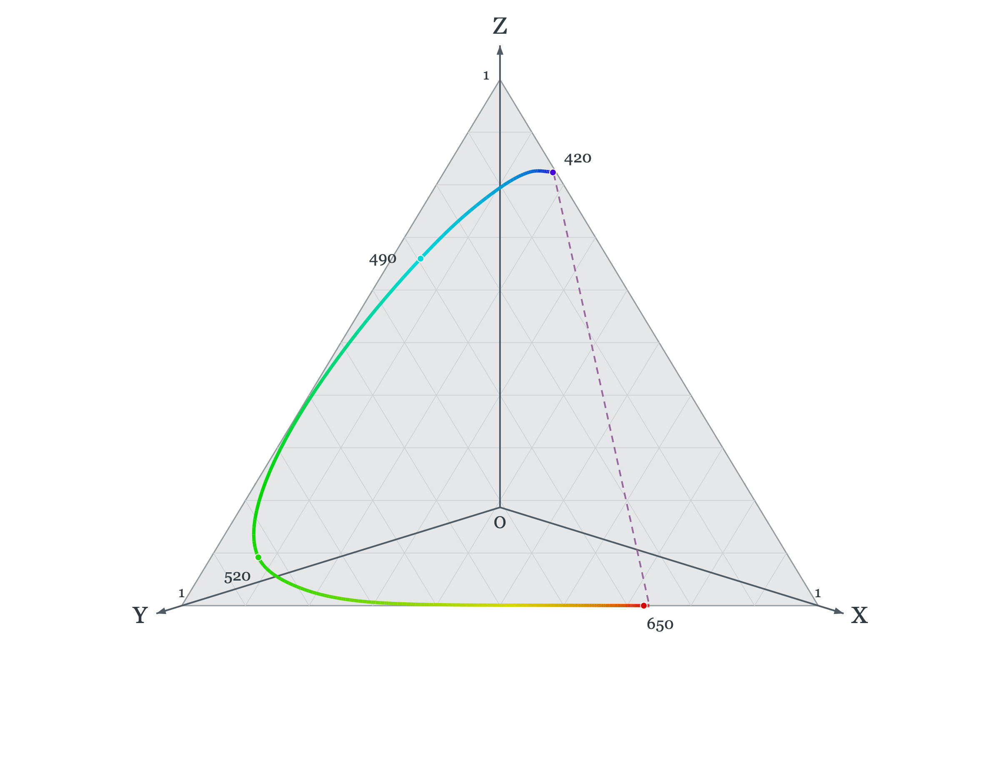{fig-alt="Gray xy normalization plane meeting all three positive XYZ axes at one, with the spectrum locus plotted on the plane." width="90%"}
:::

The xy chromaticity plane and spectrum locus in XYZ space, shown with equal axis scales. In the HTML version, drag to rotate and use the controls to zoom or show a radial projection from the origin.
:::

The spectrum locus shown on the plane is fundamental because it forms the outer boundary of the chromaticity coordinates for all physical lights. This property follows directly from a geometric rule of chromaticity diagrams: the chromaticity of an additive mixture of two lights always lies on the straight line segment connecting their individual chromaticities (see @nte-chromaticity-mixture). Because every physical light is a non-negative mixture of spectral lights, the chromaticity of any real light must lie inside the convex hull of the spectrum locus, bounded below by the straight "line of purples" connecting the short- and long-wavelength ends of the spectrum.

The approximate color appearance across the CIE 1931 $(x, y)$ chromaticity diagram is illustrated schematically in @fig-chromaticity-appearance. White and neutral grays fall near the center of the diagram. The saturated spectral lights lie along the outer boundary.

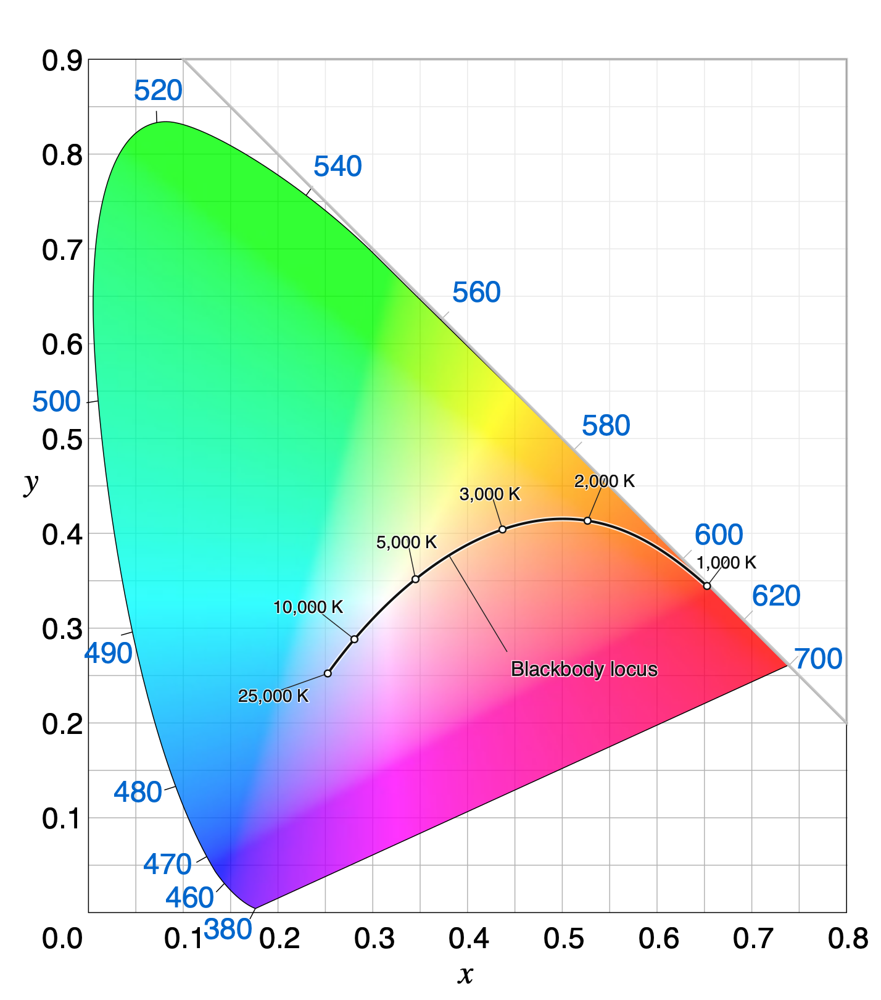{#fig-chromaticity-appearance width="50%"}


::: {.callout-note title="Chromaticity of the mixture of two lights" collapse="true" #nte-chromaticity-mixture}
The chromaticity coordinate of an additive mixture of two lights lies on the straight line segment connecting their chromaticities.

Suppose Light 1 and Light 2 have CIE tristimulus vectors $\mathbf{C}_1 = (X_1, Y_1, Z_1)$ and $\mathbf{C}_2 = (X_2, Y_2, Z_2)$, with coordinate sums

$$
S_1 = X_1 + Y_1 + Z_1 \quad \text{and} \quad S_2 = X_2 + Y_2 + Z_2 .
$$

From @eq-chromaticity, the 2D chromaticity coordinates $\mathbf{c}_1 = (x_1, y_1)$ and $\mathbf{c}_2 = (x_2, y_2)$ satisfy

$$
(X_1, Y_1) = S_1 (x_1, y_1) \quad \text{and} \quad (X_2, Y_2) = S_2 (x_2, y_2) .
$$

By superposition, mixing the two lights sums their tristimulus vectors:

$$
\mathbf{C}_3 = (X_1 + X_2, \; Y_1 + Y_2, \; Z_1 + Z_2) .
$$

The coordinate sum of the mixture is $S_3 = S_1 + S_2$, so the chromaticity of the mixture $\mathbf{c}_3 = (x_3, y_3)$ is

$$
\begin{aligned}
x_3 &= \frac{X_1 + X_2}{S_1 + S_2} = \frac{S_1 x_1 + S_2 x_2}{S_1 + S_2} = \left(\frac{S_1}{S_1 + S_2}\right) x_1 + \left(\frac{S_2}{S_1 + S_2}\right) x_2 , \\
y_3 &= \frac{Y_1 + Y_2}{S_1 + S_2} = \frac{S_1 y_1 + S_2 y_2}{S_1 + S_2} = \left(\frac{S_1}{S_1 + S_2}\right) y_1 + \left(\frac{S_2}{S_1 + S_2}\right) y_2 .
\end{aligned}
$$

Defining $\alpha = \frac{S_1}{S_1 + S_2}$, we see that $1 - \alpha = \frac{S_2}{S_1 + S_2}$, with $0 < \alpha < 1$ whenever $S_1, S_2 > 0$. In vector form, the chromaticity of the mixture is a convex combination of $\mathbf{c}_1$ and $\mathbf{c}_2$:

$$
\mathbf{c}_3 = \alpha \mathbf{c}_1 + (1 - \alpha) \mathbf{c}_2 .
$$

As the relative intensities of the two lights vary, $\mathbf{c}_3$ sweeps out the line segment connecting $\mathbf{c}_1$ and $\mathbf{c}_2$ in the $(x, y)$ chromaticity diagram.
:::

### Common terms associated with the chromaticity diagram {#sec-chromaticity-terms}

We plot these values by projecting the plane orthographically onto the $(x, y)$ axes. This produces the standard two-dimensional **CIE $(x, y)$ chromaticity diagram** (@fig-chromaticity-appearance). Several classic colorimetric concepts and engineering tools are described on the chromaticity diagram.

**Blackbody (Planckian) locus** As the temperature of a blackbody radiator increases from $2000\text{ K}$ to $9000\text{ K}$, its spectral power distribution shifts toward shorter wavelengths, tracing a smooth arc from orange-red through neutral white to bluish-white near the center of the chromaticity diagram (@fig-chromaticity-appearance).

**Complementary wavelengths** are defined as a pair of monochromatic lights whose additive mixture can match a chosen reference white (such as CIE D65; @fig-chromaticity-complementary). **Dominant wavelength** is defined by a ray from the reference white point through a test light's chromaticity out to the spectrum locus (@fig-chromaticity-dominant). The fractional distance along the segment from white to the boundary quantifies the excitation **purity**. 

::: {#fig-chromaticity-complementary-dominant layout-ncol=2}
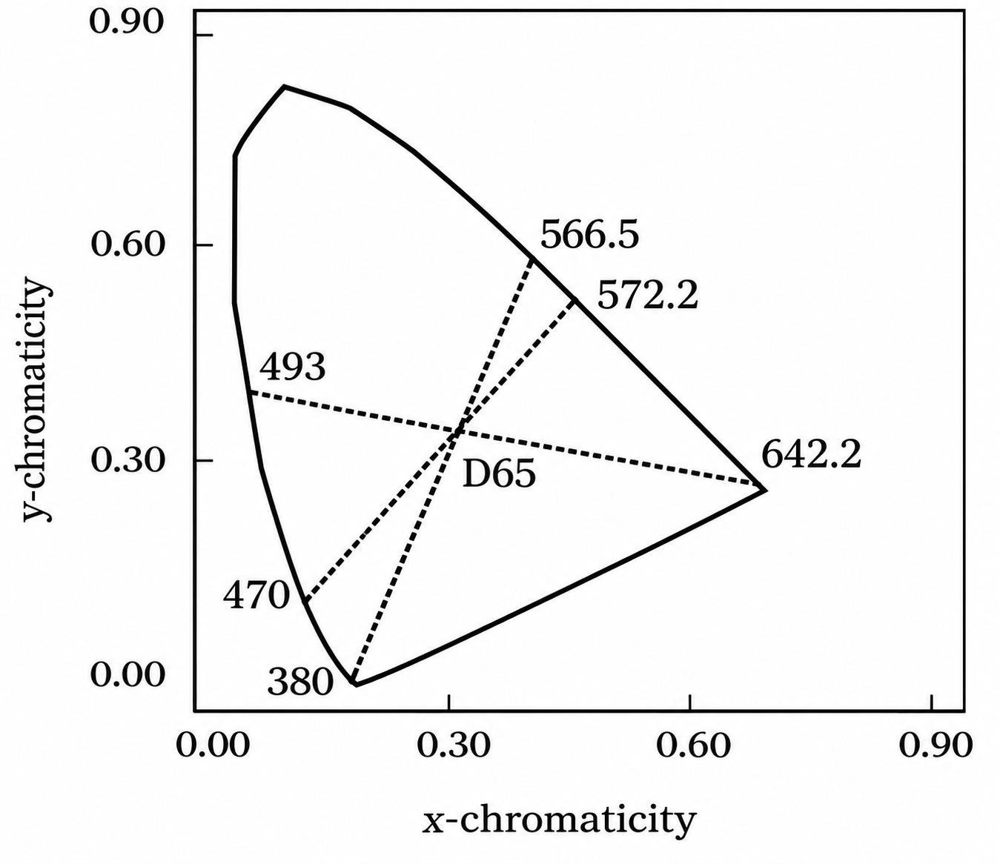{#fig-chromaticity-complementary}

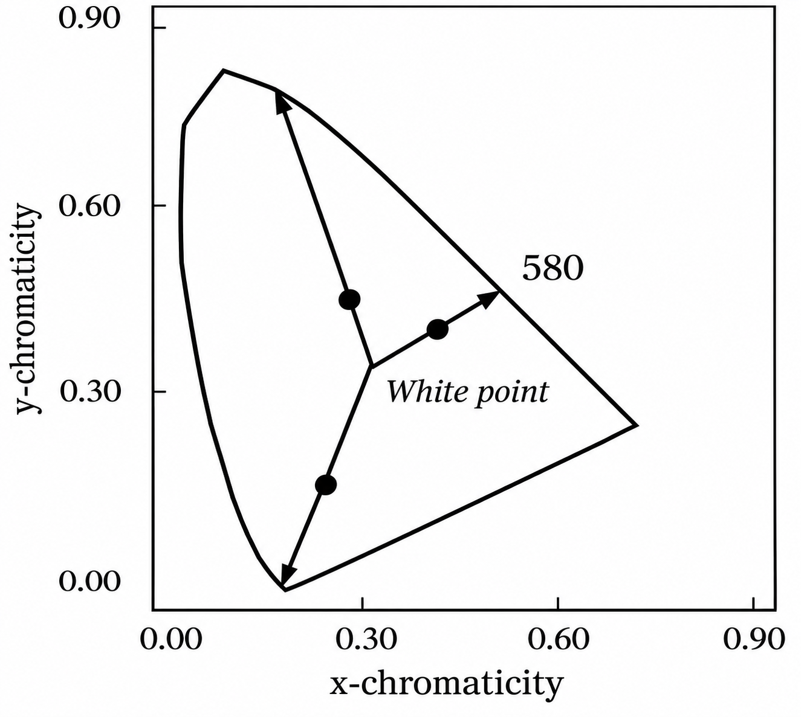{#fig-chromaticity-dominant}

Complementary wavelengths and dominant wavelength constructions on the CIE $(x, y)$ chromaticity diagram.
:::

### Display gamuts {#sec-chromaticity-gamuts}

One of the most common and practical uses of chromaticity coordinates is to visualize the range of colors a display can produce (@sec-display-color-matching). The two-dimensional chromaticity gamut follows directly from the two-light mixture rule (@nte-chromaticity-mixture): any non-negative additive combination of three primary lights ($R$, $G$, and $B$) lies inside the **triangle** whose vertices are the chromaticities of the three primaries (@fig-chromaticity-gamut).

::: {#fig-chromaticity-gamuts-panel .figure}
::: {.panel-tabset}

### Display primary triangle
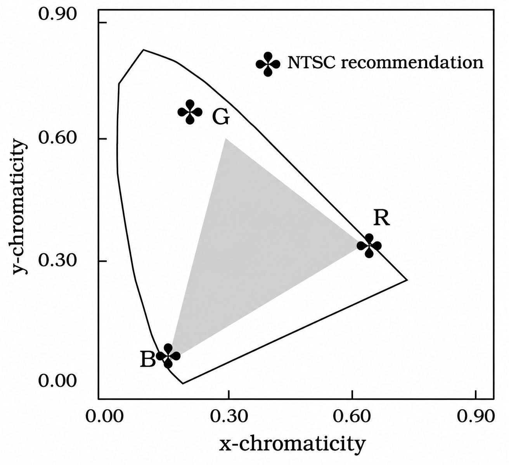{#fig-chromaticity-gamut width="75%"}

### Display gamut vs. human vision
, CC BY-SA 3.0).](images/human/06-color-metrics/chromaticity/cie-xy-gamuts-industry.png){#fig-chromaticity-multiple-gamuts width="75%"}

:::
Visualizing display color reproduction limits as triangles in the CIE $(x, y)$ chromaticity diagram.
:::

Any chromaticity inside the triangle defined by the three primaries can be reproduced by the display; any chromaticity outside the triangle would require a negative weight on at least one primary (@eq-display-primary-weights) and is out of gamut. Keep two caveats in mind when interpreting these chromaticity triangles:

1. **Chromaticity omits luminance.** The $(x, y)$ triangle is a two-dimensional projection of the three-dimensional color solid swept out over the valid range of primary intensities. The projection does not show how the range of achievable chromaticities shrinks near the display's peak luminance (where primaries saturate) or near its black level (where ambient flare and dark light dominate).
2. **Displays have primary gamuts; sensors do not.** While a three-primary display is physically restricted to the convex triangle of its emitters (@fig-chromaticity-multiple-gamuts), a camera sensor does not emit primaries—it is designed to respond to light across the visible spectrum. People sometimes use the phrase "sensor gamut," which has never seemed like a good idea to me. The meaningful engineering question for a sensor is how accurately its responses can be transformed into the human visual encoding—a topic we return to later.

## Representing perceptual differences {#sec-perceptual-differences}

Almost right away, engineers noted that the $(x, y)$ diagram has an important practical shortcoming: equal distances on the chart do not correspond to equal perceptual differences. A large upper region of the $(x, y)$ diagram appears green with relatively little change in perceived hue across long distances, whereas in the blue and purple regions a small step produces a large change in color appearance (@fig-chromaticity-appearance).

This was demonstrated in a very compelling set of measurements from Kodak Laboratories as part of a large color research program led by David MacAdam [@macadam1942-ellipses]. His experimental measurements included an analysis of how discriminable colors were from one another. He made his measurements in the constant-Y plane (equiluminance). The participants made multiple matches to a target, and MacAdam used the standard deviation of the settings in different directions within the plane to define an ellipse. This ellipse measures the equal-discriminability of the lights in the plane. The shape and size of these ellipses, now called the *MacAdam ellipses*, differ greatly between different positions in the plane.

![MacAdam ellipses plotted for one subject, "PGN"[^PGN]. The ellipses were measured on a constant Y plane, but they are commonly plotted on the CIE 1931 $(x, y)$ chromaticity diagram at ten times their actual size (source: [Wikimedia Commons](https://commons.wikimedia.org/w/index.php?curid=173591), CC BY-SA 3.0).](images/human/06-color-metrics/chromaticity/CIExy1931_MacAdam.png){#fig-cie-xy-macadam width="60%"}

[^PGN]: From the acknowledgements in @macadam1942-ellipses: "It is a pleasure to acknowledge again the essential contributions of Mr. Perley G. Nutting, Jr., whose critical interest in the ideas involved in this research was much greater and more helpful than is implied by the fact that he was the principal observer."

### $(u', v')$ chromaticity coordinates {#sec-uv-chromaticity}
The size and orientation of the MacAdam ellipses vary greatly with chromaticity, being especially large in the green region of the chromaticity diagram (@fig-cie-xy-macadam). In response to this shortcoming, alternative chromaticity coordinates were proposed with the goal of making a representation whose differences are more perceptually equal.

The **CIE 1976 $(u', v')$ Uniform Chromaticity Scale (UCS)** diagram[^uv1960] is an influential alternative to $(x, y)$. @eq-uv-chromaticity is also a projective mapping, but in this case we measure how each ray intersects the plane $X + 15Y + 3Z = 1$. Also, notice that the projection onto the $(u', v')$ plane is followed by axis scale factors of $4$ and $9$ (@fig-uv-plane-interactive). Differences in these coordinates are more closely matched to perceptual differences. The formula for $u'$ and $v'$ is

[^uv1960]: The 1976 UCS is an improvement upon an earlier CIE 1960 UCS definition, $u = u'$ and $v = \frac{2}{3}v' = \frac{6Y}{X + 15Y + 3Z}$.

$$
u' = \frac{4X}{X + 15Y + 3Z}, \qquad v' = \frac{9Y}{X + 15Y + 3Z} .
$$ {#eq-uv-chromaticity}

You can rotate and inspect the $(u', v')$ normalization plane $X + 15Y + 3Z = 1$ and its spectrum locus in three dimensions in @fig-uv-plane-interactive.

::: {#fig-uv-plane-interactive}

::: {.content-visible when-format="html"}
<iframe src="images/human/06-color-metrics/chromaticity/uv-plane-3d.html" title="Interactive u prime v prime normalization plane and spectrum locus" width="100%" height="500" style="border:0;display:block;" loading="lazy" onload="try{var m=this.contentDocument.querySelector('main');if(m)this.style.height=Math.ceil(m.getBoundingClientRect().height)+'px'}catch(e){}"></iframe>
:::

::: {.content-visible unless-format="html"}
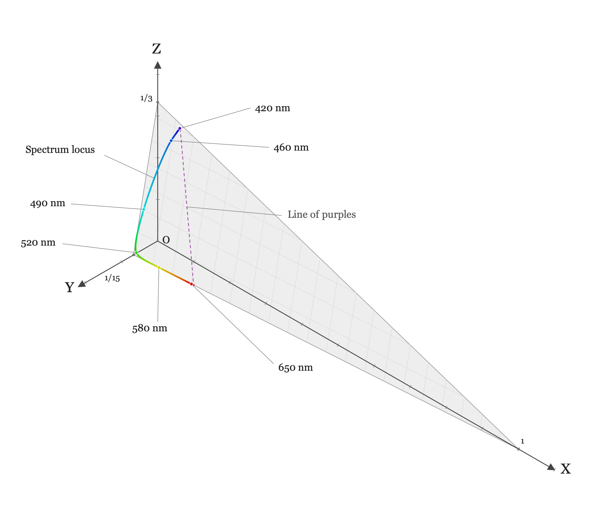{fig-alt="Gray u prime v prime normalization plane meeting the XYZ axes at one, one fifteenth, and one third, with the spectrum locus plotted on the plane." width="90%"}
:::

The u′, v′ normalization plane and spectrum locus in XYZ space, shown with equal axis scales. In the HTML version, drag to rotate and use the controls to zoom or show a radial projection from the origin.
:::

@fig-uv-blackbody-geometry provides a sense of the color appearance at different locations in the $(u',v')$ plane, along with the position of the blackbody locus.

, public domain).](images/human/06-color-metrics/chromaticity/CIE_1976_UCS-wikipedia-blackbody.png){#fig-uv-blackbody-geometry width="50%"}

Because this mapping is still a central projection onto a plane, additive mixtures of lights continue to lie on straight line segments, and display gamuts remain triangles.

Both chromaticity representations discard luminance, which is an important feature of the light. When describing a light, it is common to inform users about luminance by including the $Y$ value. Thus, you will often see people describing a light with three values, $Yxy$ or $Yu'v'$. It is straightforward to convert those three values to recover the $(X,Y,Z)$ values.

## CIELAB {#sec-cielab}
There are two shortcomings we would like to address concerning the chromaticity representations.

First, the $(u', v')$ improves the uniformity of two-dimensional chromaticity spacing, but it remains a two-dimensional measure of a three-dimensional signal. To quantify the full perceptual difference between two lights - which will generally differ in both luminance and chromaticity - we need to expand the metric to include all three dimensions.

Second, the human visual adjusts its properties substantially as it changes between contexts, say from inside a room to outside in the sun. These adjustments - often called light- and dark-adaptation - substantially change visual sensitivity and thus have a big impact on how well we can discriminate between different lights.

In 1976 the CIE completed work on the color metrics that address these two issues. The metrics account for all three dimensions, and they include parameters about the ambient viewing conditions which determine the likely state of adaptation. 

The CIE committee members could not come to an agreement on a single metric, and they approved two standard discrimination metrics: CIELUV and CIELAB. The CIELUV metric is an extension of the $(u',v')$ system, and it was favored by key individuals (Günther Wyszecki) who wanted the new system to preserve a projective chromaticity diagram while accounting for the ambient white point $(X_n, Y_n, Z_n)$:

$$
\begin{aligned}
L^* &= \begin{cases}
116 \left(\frac{Y}{Y_n}\right)^{1/3} - 16, & \frac{Y}{Y_n} > \left(\frac{6}{29}\right)^3 \approx 0.008856, \\[6pt]
\left(\frac{29}{3}\right)^3 \frac{Y}{Y_n} \approx 903.3\,\frac{Y}{Y_n}, & \frac{Y}{Y_n} \le \left(\frac{6}{29}\right)^3,
\end{cases} \\[8pt]
u^* &= 13\, L^* (u' - u'_n), \\[4pt]
v^* &= 13\, L^* (v' - v'_n),
\end{aligned}
$$ {#eq-cieluv}

where $(u'_n, v'_n)$ are the $(u', v')$ chromaticity coordinates of the reference white point from @eq-uv-chromaticity, and the perceptual color difference between two lights is the Euclidean distance $\Delta E^*_{uv} = \sqrt{(\Delta L^*)^2 + (\Delta u^*)^2 + (\Delta v^*)^2}$.

The ambient white point values are the $u'_n,v'_n$ chromaticity coordinates and $Y_n$ value of a white reflective surface under the ambient illumination conditions. These values provide information about the viewer's likely state of adaptation, and the CIELUV values $(L^*,u^*,v^*)$ are all specified in terms of the white point values.

Another group—including **R. W. G. (Bob) Hunt** and researchers in the surface-color and textile industries—favored the **CIELAB** formula, which simplified the earlier **Adams–Nickerson** opponent-color space developed by Elliot Q. Adams and Dorothy Nickerson. Rather than preserving a projective chromaticity diagram, CIELAB normalizes each tristimulus value $(X, Y, Z)$ directly by the ambient white point $(X_n, Y_n, Z_n)$ and applies a compressive nonlinearity before taking opponent differences:

$$
\begin{aligned}
L^* &= 116\, f\!\left(\frac{Y}{Y_n}\right) - 16, \\[6pt]
a^* &= 500 \left[ f\!\left(\frac{X}{X_n}\right) - f\!\left(\frac{Y}{Y_n}\right) \right], \\[6pt]
b^* &= 200 \left[ f\!\left(\frac{Y}{Y_n}\right) - f\!\left(\frac{Z}{Z_n}\right) \right],
\end{aligned}
$$ {#eq-cielab}

where the piecewise compressive function $f(t)$ is

$$
f(t) = \begin{cases}
t^{1/3}, & t > \left(\frac{6}{29}\right)^3 \approx 0.008856, \\[6pt]
\frac{1}{3}\left(\frac{29}{6}\right)^2 t + \frac{4}{29} \approx 7.787\,t + \frac{16}{116}, & t \le \left(\frac{6}{29}\right)^3 .
\end{cases}
$$ {#eq-cielab-f}

Notice that $L^*$ in @eq-cielab is identical to $L^*$ in @eq-cieluv.

### Color appearance
The three dimensions of the CIELAB representation correspond to three intuitive variables.  The $L^*$ variable describes the lightness, running from black ($0$) to a white surface ($100$).  The $a^*$ dimension runs between very red (positive) to neutral to very green (negative).  The $b^*$ dimension runs from very yellow (positive) to neutral to very blue (negative).

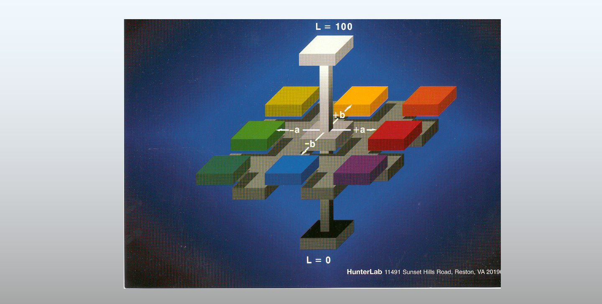{#fig-pattern-color}

This organization of surface colors builds directly on the system introduced in 1905 by the American painter and art teacher **Albert H. Munsell** (*A Color Notation*). Seeking a "rational way to describe color" for students and artisans—analogous to musical notation—Munsell combined visual scaling judgments with photometric measurements to arrange painted samples into perceptually uniform steps. He published these in his *Atlas of the Munsell Color System* (1915), which evolved into the *Munsell Book of Color* (1929) and remains widely used in design, manufacturing, and color science.

::: {#fig-munsell-appearance}
:::: {.panel-tabset}

#### Book of Color
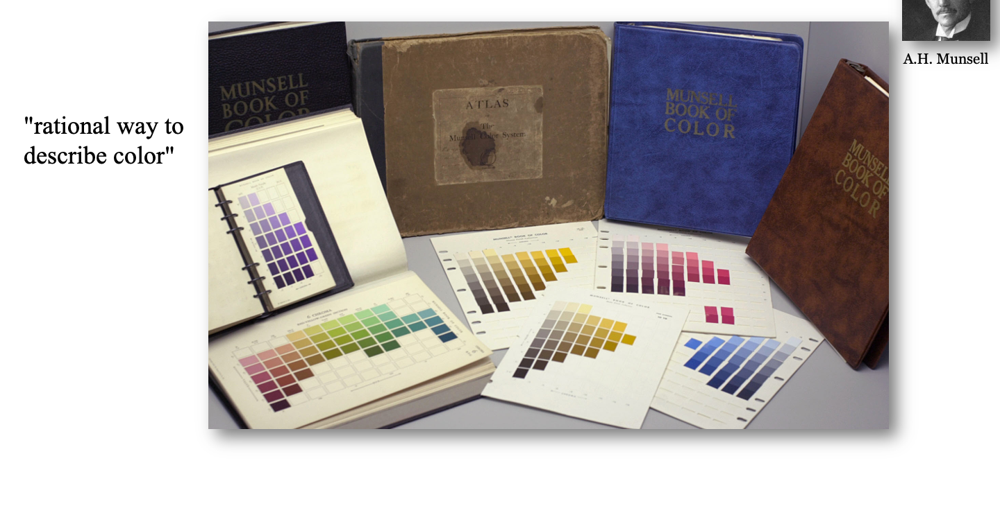{#fig-munsell-appearance-book width="80%"}

#### Color Tree
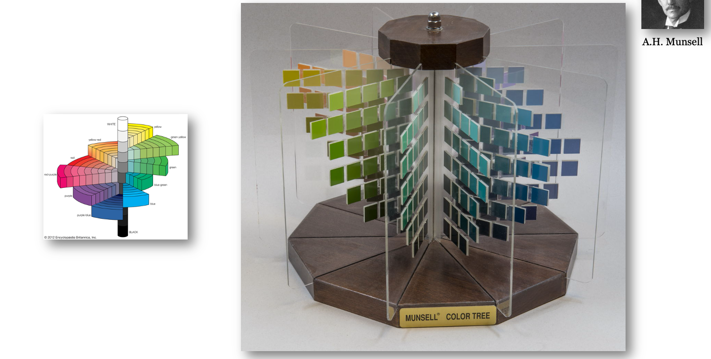{#fig-munsell-appearance-model width="80%"}

#### Hue, value, and chroma
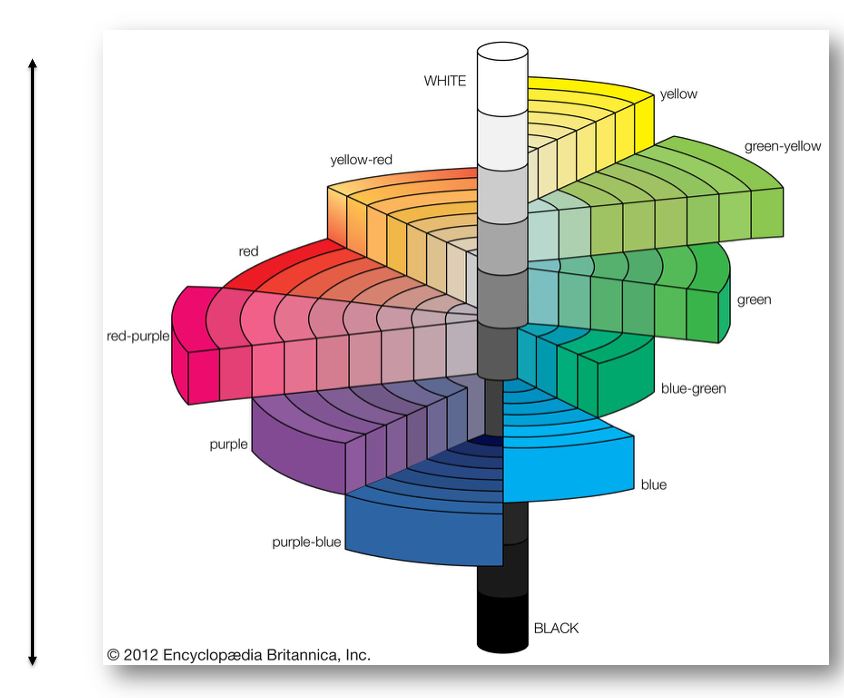{#fig-munsell-appearance-slices width="80%"}

::::
The Munsell color order system organizes surface colors perceptually by **hue** (color family, such as red or yellow-red), **value** (lightness, from $0$ for ideal black to $10$ for ideal white), and **chroma** (departure from neutral gray, analogous to saturation). Chips are labeled in `Hue Value/Chroma` notation—for example, `2.5YR 5/10` denotes a yellow-red hue, mid-level lightness ($5$), and a chroma of $10$. Unlike value, chroma is open-ended and varies by hue and lightness (the asymmetric shape of the Color Tree reflects the different maximum chromas attainable with real pigments). While Munsell steps are designed to be perceptually uniform, the notation describes appearance rather than a linear light-mixing space, so you cannot add two Munsell coordinates to predict an additive mixture the way you can with CIE $(X, Y, Z)$.
:::


::: {.callout-note title="Munsell notation and renotation" collapse="true"}

::: {style="float: left; width: 30%; margin: 0 1.25rem 0.5rem 0;"}
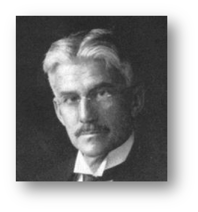{#fig-albert-munsell width="100%"}
:::

As the Munsell system gained wide adoption in industry, art, and science, the **Optical Society of America** (now Optica) formed a Subcommittee on the Spacing of the Munsell Colors—led by Sidney M. Newhall, Dorothy Nickerson, and Deane B. Judd—to evaluate and refine its perceptual uniformity. Between 1937 and 1943, the committee combined spectrophotometric measurements of the 1929 *Munsell Book of Color* chips under **CIE Illuminant C** with millions of visual judgments to smooth and adjust the spacing of hue, value, and chroma in CIE $(x, y, Y)$ space.

The resulting **Munsell Renotation System** (1943) published idealized CIE $(x, y, Y)$ coordinates for every Munsell notation, turning a physical collection of painted chips into a quantitative colorimetric standard tied directly to CIE $\mathbf{XYZ}$. The Munsell Color Company then reformulated its chips to match the renotation targets, and later spectrophotometric surveys [@nickerson1957-munsellreflectance; @parkkinen1989-munsellspectra] made the full spectral reflectance curves of Munsell chips a standard dataset in color and imaging science.

::: {style="clear: both;"}
:::

:::

### Color difference metric: $\Delta E$

A key point for both of these representations is to make the perceptual difference between two lights match the Euclidean distance between their representation.  We use the symbol $\Delta E$ to denote the Euclidean difference, and we add a subscript to undicate whether we are measuring in CIELUV or CIELAB space, such as 
$$
\Delta E^*_{ab} = \sqrt{(\Delta L^*)^2 + (\Delta a^*)^2 + (\Delta b^*)^2}
$${#eq-delta-E-ab}

The two representations are not the same, but they are not wildly different either.  We can judge the similarity by plotting the equal-difference contours (a circle) in one space (CIELAB) in the other space (CIELUV). We can also transform a grid from CIELAB space into CIELUV space. The interactive plots in @fig-cieluv-vs-cielab provide a sense of how these two representations differ.

::: {#fig-cieluv-vs-cielab}

::: {.content-visible when-format="html"}
::: {style="width: 100%; margin: 0 auto; overflow: visible; font-size: 0.95rem;"}

```{ojs}
//| echo: false
viewof luv_lab_Lstar = Inputs.range([30, 85], {
  value: 65,
  step: 5,
  label: "Lightness L*"
})

viewof luv_lab_preset = Inputs.select(
  [
    { name: "Neutral (D65 white)", a: 0, b: 0 },
    { name: "Red-orange", a: 45, b: 35 },
    { name: "Yellow-green", a: -20, b: 50 },
    { name: "Green", a: -45, b: 25 },
    { name: "Cyan", a: -30, b: -20 },
    { name: "Blue", a: 15, b: -50 },
    { name: "Magenta", a: 45, b: -30 }
  ],
  {
    label: "Test light",
    format: d => d.name,
    value: { name: "Red-orange", a: 45, b: 35 }
  }
)
```

```{ojs}
//| echo: false
luv_lab_calc = {
  const Xn = 95.047, Yn = 100.0, Zn = 108.883;
  const denom_n = Xn + 15 * Yn + 3 * Zn;
  const un = (4 * Xn) / denom_n;
  const vn = (9 * Yn) / denom_n;
  const delta = 6 / 29;

  function finv(t) {
    return t > delta ? t * t * t : 3 * delta * delta * (t - 4 / 29);
  }

  function lab2xyz(L, a, b) {
    const fy = (L + 16) / 116;
    const fx = a / 500 + fy;
    const fz = fy - b / 200;
    return [
      Math.max(0, Xn * finv(fx)),
      Math.max(0, Yn * finv(fy)),
      Math.max(0, Zn * finv(fz))
    ];
  }

  function xyz2uv(X, Y, Z) {
    const d = X + 15 * Y + 3 * Z;
    if (d <= 0) return [0, 0];
    return [(4 * X) / d, (9 * Y) / d];
  }

  function lab2luv(L, a, b) {
    const [X, Y, Z] = lab2xyz(L, a, b);
    const [up, vp] = xyz2uv(X, Y, Z);
    return [13 * L * (up - un), 13 * L * (vp - vn)];
  }

  // Approximate display color for a (L, a, b) point (for visual cue only)
  function lab2css(L, a, b) {
    const [X, Y, Z] = lab2xyz(L, a, b);
    const x = X / 100, y = Y / 100, z = Z / 100;
    let r =  3.2406 * x - 1.5372 * y - 0.4986 * z;
    let g = -0.9689 * x + 1.8758 * y + 0.0415 * z;
    let bl = 0.0557 * x - 0.2040 * y + 1.0570 * z;
    const compand = c => {
      const clamped = Math.max(0, Math.min(1, c));
      return clamped <= 0.0031308 ? 12.92 * clamped : 1.055 * Math.pow(clamped, 1 / 2.4) - 0.055;
    };
    return `rgb(${Math.round(compand(r)*255)}, ${Math.round(compand(g)*255)}, ${Math.round(compand(bl)*255)})`;
  }

  const L = luv_lab_Lstar;
  const radius = 15;
  const a0 = luv_lab_preset.a;
  const b0 = luv_lab_preset.b;
  const [u0, v0] = lab2luv(L, a0, b0);

  const circlePts = [];
  const refUvPts = [];
  let minDEuv = Infinity;
  let maxDEuv = 0;

  const N = 72;
  for (let i = 0; i <= N; i++) {
    const theta = (2 * Math.PI * i) / N;
    const a = a0 + radius * Math.cos(theta);
    const b = b0 + radius * Math.sin(theta);
    const [u, v] = lab2luv(L, a, b);
    const dEuv = Math.hypot(u - u0, v - v0);
    if (i < N) {
      if (dEuv < minDEuv) minDEuv = dEuv;
      if (dEuv > maxDEuv) maxDEuv = dEuv;
    }
    circlePts.push({ i, a, b, u, v, dEuv, color: lab2css(L, a, b) });
    refUvPts.push({
      i,
      u: u0 + radius * Math.cos(theta),
      v: v0 + radius * Math.sin(theta)
    });
  }

  // Constant-a* and constant-b* grid lines to show nonlinear warp
  const gridLines = [];
  const vals = [-60, -30, 0, 30, 60];
  for (const av of vals) {
    for (let bv = -60; bv <= 60; bv += 5) {
      const [u, v] = lab2luv(L, av, bv);
      gridLines.push({ series: `a=${av}`, a: av, b: bv, u, v });
    }
  }
  for (const bv of vals) {
    for (let av = -60; av <= 60; av += 5) {
      const [u, v] = lab2luv(L, av, bv);
      gridLines.push({ series: `b=${bv}`, a: av, b: bv, u, v });
    }
  }

  return {
    L,
    radius,
    a0,
    b0,
    u0,
    v0,
    centerColor: lab2css(L, a0, b0),
    circlePts,
    refUvPts,
    gridLines,
    minDEuv,
    maxDEuv
  };
}
```

```{ojs}
//| echo: false
html`<div style="display: grid; grid-template-columns: repeat(auto-fit, minmax(290px, 1fr)); gap: 16px; align-items: start;">
  <div>
    ${Plot.plot({
      title: `CIELAB (a*, b*) at L* = ${luv_lab_calc.L}`,
      width: 360,
      height: 360,
      aspectRatio: 1,
      marginLeft: 48,
      marginBottom: 42,
      x: { label: "a* (red–green)", domain: [-90, 90] },
      y: { label: "b* (yellow–blue)", domain: [-90, 90] },
      marks: [
        Plot.gridX({ strokeOpacity: 0.15 }),
        Plot.gridY({ strokeOpacity: 0.15 }),
        Plot.ruleX([0], { stroke: "#999", strokeDasharray: "3,3" }),
        Plot.ruleY([0], { stroke: "#999", strokeDasharray: "3,3" }),
        Plot.line(luv_lab_calc.gridLines, {
          x: "a",
          y: "b",
          z: "series",
          stroke: "#cfd8dc",
          strokeWidth: 1
        }),
        Plot.line(luv_lab_calc.circlePts, {
          x: "a",
          y: "b",
          stroke: "#1f2937",
          strokeWidth: 2.2
        }),
        Plot.dot([{ a: luv_lab_calc.a0, b: luv_lab_calc.b0, c: luv_lab_calc.centerColor }], {
          x: "a",
          y: "b",
          r: 6,
          fill: "c",
          stroke: "#111",
          strokeWidth: 1.5
        })
      ]
    })}
  </div>
  <div>
    ${Plot.plot({
      title: `CIELUV (u*, v*) at L* = ${luv_lab_calc.L}`,
      width: 360,
      height: 360,
      aspectRatio: 1,
      marginLeft: 48,
      marginBottom: 42,
      x: { label: "u*", domain: [-110, 110] },
      y: { label: "v*", domain: [-110, 110] },
      marks: [
        Plot.gridX({ strokeOpacity: 0.15 }),
        Plot.gridY({ strokeOpacity: 0.15 }),
        Plot.ruleX([0], { stroke: "#999", strokeDasharray: "3,3" }),
        Plot.ruleY([0], { stroke: "#999", strokeDasharray: "3,3" }),
        Plot.line(luv_lab_calc.gridLines, {
          x: "u",
          y: "v",
          z: "series",
          stroke: "#cfd8dc",
          strokeWidth: 1
        }),
        Plot.line(luv_lab_calc.refUvPts, {
          x: "u",
          y: "v",
          stroke: "#64748b",
          strokeDasharray: "4,4",
          strokeWidth: 1.5
        }),
        Plot.line(luv_lab_calc.circlePts, {
          x: "u",
          y: "v",
          stroke: "#b91c1c",
          strokeWidth: 2.2
        }),
        Plot.dot([{ u: luv_lab_calc.u0, v: luv_lab_calc.v0, c: luv_lab_calc.centerColor }], {
          x: "u",
          y: "v",
          r: 6,
          fill: "c",
          stroke: "#111",
          strokeWidth: 1.5
        })
      ]
    })}
  </div>
</div>
<p style="margin-top: 8px; font-size: 0.9rem; color: #374151;">
  <strong>Selected test light (${luv_lab_preset.name}):</strong>
  (a*, b*) = (${luv_lab_calc.a0.toFixed(0)}, ${luv_lab_calc.b0.toFixed(0)})
  &rarr; (u*, v*) = (${luv_lab_calc.u0.toFixed(1)}, ${luv_lab_calc.v0.toFixed(1)}).
  Around the constant &Delta;E*<sub>ab</sub> = 15 circle (solid), &Delta;E*<sub>uv</sub> ranges from
  <strong>${luv_lab_calc.minDEuv.toFixed(1)}</strong> to <strong>${luv_lab_calc.maxDEuv.toFixed(1)}</strong>
  (dashed circle shows &Delta;E*<sub>uv</sub> = 15).
</p>`
```

:::
:::

::: {.content-visible unless-format="html"}
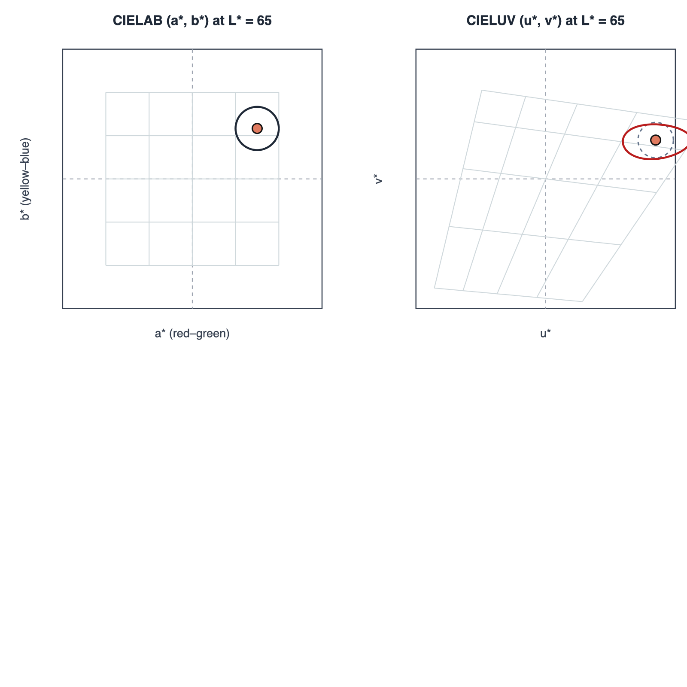{fig-alt="Side-by-side comparison of CIELAB (a*, b*) and CIELUV (u*, v*) at L* = 65, showing a constant Delta E*ab = 15 circle around a red-orange test light mapped into a warped contour in (u*, v*) alongside a dashed Delta E*uv = 15 reference circle." width="90%"}
:::

Comparison of CIELAB $(a^*, b^*)$ and CIELUV $(u^*, v^*)$ at constant lightness $L^*$ under a D65 white point. A regular grid and a circle of constant $\Delta E^*_{ab} = 15$ (solid) in $(a^*, b^*)$ warp nonlinearly in $(u^*, v^*)$, where the dashed circle marks $\Delta E^*_{uv} = 15$. Use the controls in the HTML version to vary $L^*$ and the test light.
:::

Over time, the CIELAB representation has been more widely used than CIELUV, and it has been extended and amended in various ways. CIELUV remains useful primarily in display and lighting engineering because it preserves the projective $(u', v')$ chromaticity diagram, while CIELAB and CIEDE2000 dominate perceptual color-difference evaluation. 

::: {.callout-note title="The rise of CIELAB" collapse="true"}

Two lines of evidence show how CIELAB became the dominant CIE color-difference standard over CIELUV:

**Scholarly usage:** A search of the [OpenAlex](https://openalex.org/) scholarly literature database (November 2026) illustrates the gap in adoption across imaging, printing, textiles, and vision science:

| Term | Matching Works |
|---|---:|
| `"CIELAB"` | 46,499 |
| `"CIELUV"` | 1,893 |
| `"CIEDE2000"` | 5,513 |
| `"CIE94"` | 605 |

`"CIELAB"` appears roughly **25×** more often than `"CIELUV"`, and `"CIEDE2000"` alone appears nearly **3×** more often than `"CIELUV"`.

:::

These later CIE standards leave the $(L^*, a^*, b^*)$ coordinate representation itself intact and change only **how color differences ($\Delta E$) are computed**. 

One modification to CIELAB, made in **CIE94**  Added chroma- and hue-dependent weighting functions to correct CIELAB's overestimation of perceptual differences at high chroma ($\Delta E^*_{94}$, CIE 116-1995). Rather than measuring simple Euclidean distance in $(L^*, a^*, b^*)$, they convert differences into cylindrical lightness, chroma, and hue coordinates $(L^*, C^*_{ab}, h_{ab})$ and apply a weighted, position-dependent quadratic distance (so $\Delta E$ is no longer a global Euclidean metric in a transformed 3D space):

The next modificiation, made in **CIEDE2000** Added lightness, chroma, and hue weighting functions ($S_L, S_C, S_H$), a chroma–hue interaction rotation term ($R_T$) in the blue region, and a rescaling of $a^*$ near neutral grays  ($\Delta E_{00}$, CIE 142-2001; ISO/CIE 11664-6).

## Spatial-CIELAB (S-CIELAB) {#sec-scielab}

Color appearance also depends on spatial pattern.  Just think back to chromatic aberration - how could it not?

Explain why CIELAB alone is insufficient for patterned images (depends on viewing distance and spatial frequency).

Show the S-CIELAB architecture (Zhang & Wandell, 1997):

1. Transform image into opponent-color channels (luminance, red-green, blue-yellow).
2. Filter each channel by its corresponding spatial Contrast Sensitivity Function (CSF) scaled for viewing distance (cycles per degree).
3. Transform the filtered representation back to CIE XYZ and compute point-by-point CIELAB Delta E.
Bridge forward to Part V (Displays), where CIELAB and S-CIELAB are used to evaluate display bit-depth and subpixel rendering (@sec-display-principles). -->

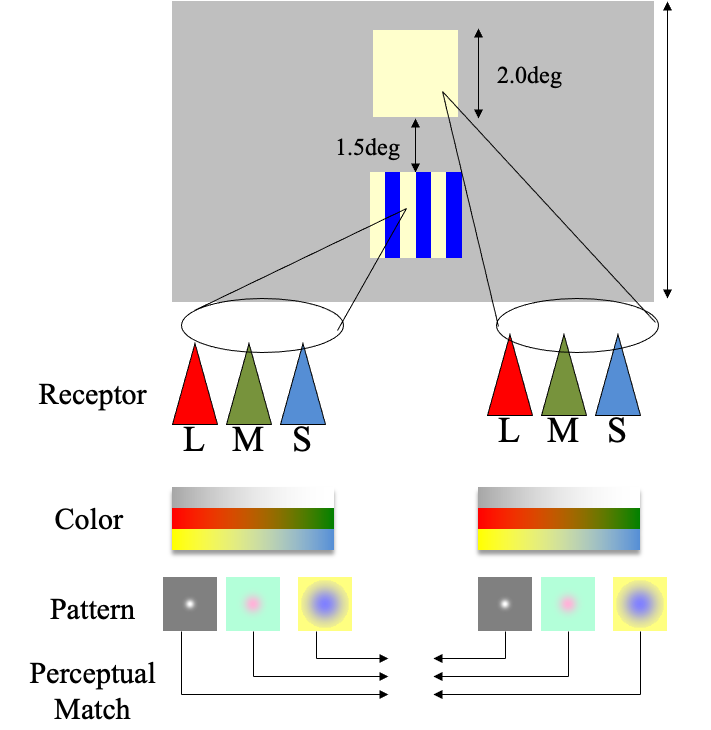{#fig-scielab-model}

More

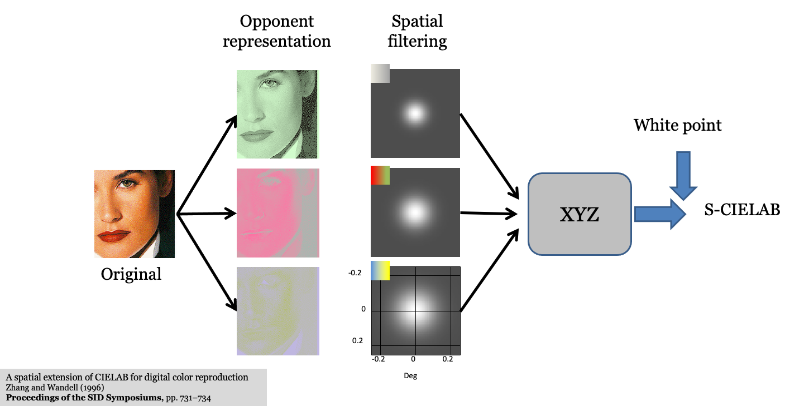{#fig-scielab-processing}
