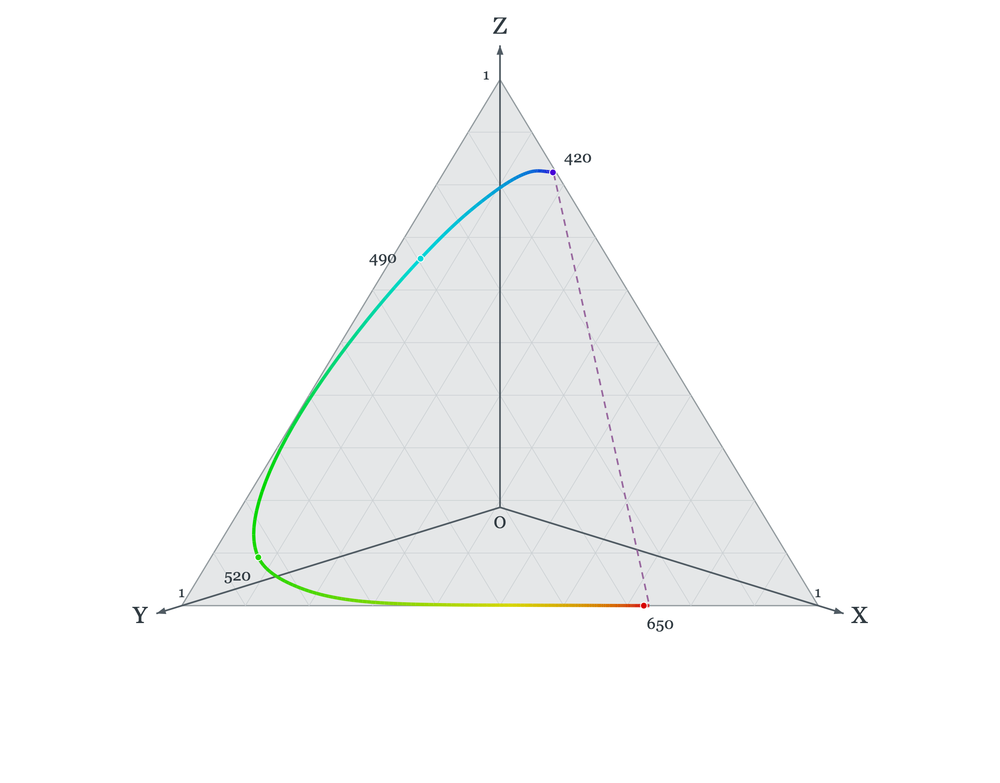
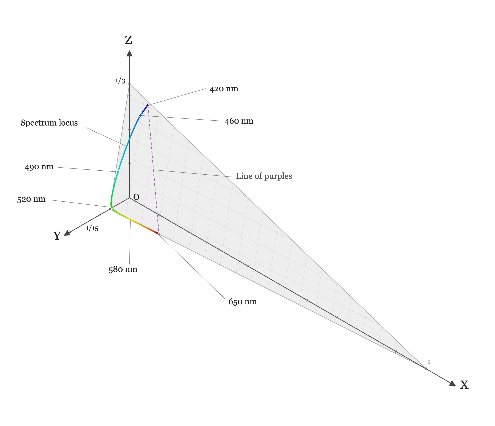

# Color representations and metrics {#sec-human-color-metrics}



## Color representations and metrics overview {#sec-human-color-metrics-overview}

@sec-human-wavelength-encoding introduced the color-matching functions and the CIE $\mathbf{XYZ}$ standard observer. The CMFs enable us to determine when two spectral power distributions match in appearance, and how a $3 \times 3$ matrix calculation determines the display primary intensities needed to reproduce a target light.

However, color matching only tells us whether two lights look *identical* ($\mathbf{C}\mathbf{t}_1 = \mathbf{C}\mathbf{t}_2$). But it misses two important facts.  First, the CMF calculation doesn't tell us what the light looks like; is it red, yellow, blue?  Second, when two lights do not match precisely the CMF calculation doesn't tell us how large the perceptual difference will appear.  These are important questions for image systems engineers.

This chapter introduces the tools used by engineers to visualize color gamuts and quantify visible color differences:

1. **Chromaticity coordinates** for separating relative spectral composition from overall intensity and visualizing display gamuts in two dimensions.
2. **CIELAB ($\Delta E_{ab}^*$)** for transforming linear tristimulus values into an approximately perceptually uniform space to measure large-field color differences.
3. **Spatial-CIELAB (S-CIELAB)** for combining the spatial contrast sensitivity functions (@sec-human-spatial-metrics) with CIELAB to predict the visibility of spatial-chromatic patterns such as halftones, color filter array artifacts, and display subpixels.

## Chromaticity coordinates {#sec-chromaticity-coordinates}

When we describe the appearance of a light, it is natural to separate its overall brightness from its hue and saturation. When the CIE set up its standards in 1931, they wanted a method to communicate about color appearance based on the color-matching values. They proposed **chromaticity coordinates (xy)** for converting the three-dimensional CIE tristimulus values, $(X, Y, Z)$, into a two-dimensional representation that separates hue and saturation from intensity.

The xy coordinates are derived from the $(X,Y,Z)$ coordinates by scaling values by the sum of the coordinates.

$$
\begin{aligned}
x &= \frac{X}{X + Y + Z}, \qquad y = \frac{Y}{X + Y + Z}, \\[6pt]
z &= \frac{Z}{X + Y + Z} = 1 - x - y .
\end{aligned}
$$ {#eq-chromaticity}

This normalization means that two lights related by $(X_1,Y_1,Z_1) = k \times (X_2, Y_2, Z_2)$ will have the same xy values.  The light intensity is normalized away.

We can visualize this mapping interactively using the three-dimensional rendering of the normalization plane and the spectrum locus in @fig-xy-plane-interactive.

::: {#fig-xy-plane-interactive}

::: {.content-visible when-format="html"}
<iframe src="images/human/06-color-metrics/chromaticity/xy-plane-3d.html" title="Interactive xy chromaticity plane and spectrum locus" width="100%" height="500" style="border:0;display:block;" loading="lazy" onload="try{var m=this.contentDocument.querySelector('main');if(m)this.style.height=Math.ceil(m.getBoundingClientRect().height)+'px'}catch(e){}"></iframe>
:::

::: {.content-visible unless-format="html"}
{fig-alt="Gray xy normalization plane meeting all three positive XYZ axes at one, with the spectrum locus plotted on the plane." width="90%"}
:::

The xy chromaticity plane and spectrum locus in XYZ space, shown with equal axis scales. In the HTML version, drag to rotate and use the controls to zoom or show a radial projection from the origin.
:::

The spectrum locus shown on the plane is fundamental because it forms the outer boundary of the chromaticity coordinates for all physical lights. This property follows directly from a geometric rule of chromaticity diagrams: the chromaticity of an additive mixture of two lights always lies on the straight line segment connecting their individual chromaticities (see @nte-chromaticity-mixture). Because every physical light is a non-negative mixture of spectral lights, the chromaticity of any real light must lie inside the convex hull of the spectrum locus, bounded below by the straight "line of purples" connecting the short- and long-wavelength ends of the spectrum.

The approximate color appearance across the CIE 1931 $(x, y)$ chromaticity diagram is illustrated schematically in @fig-chromaticity-appearance. White and neutral grays fall near the center of the diagram. The saturated spectral lights lie along the outer boundary.

{#fig-chromaticity-appearance width="50%"}

::: {.callout-note title="Chromaticity of the mixture of two lights" collapse="true" #nte-chromaticity-mixture}
The chromaticity coordinate of an additive mixture of two lights lies on the straight line segment connecting their chromaticities.

Suppose Light 1 and Light 2 have CIE tristimulus vectors $\mathbf{C}_1 = (X_1, Y_1, Z_1)$ and $\mathbf{C}_2 = (X_2, Y_2, Z_2)$, with coordinate sums

$$
S_1 = X_1 + Y_1 + Z_1 \quad \text{and} \quad S_2 = X_2 + Y_2 + Z_2 .
$$

From @eq-chromaticity, the 2D chromaticity coordinates $\mathbf{c}_1 = (x_1, y_1)$ and $\mathbf{c}_2 = (x_2, y_2)$ satisfy

$$
(X_1, Y_1) = S_1 (x_1, y_1) \quad \text{and} \quad (X_2, Y_2) = S_2 (x_2, y_2) .
$$

By superposition, mixing the two lights sums their tristimulus vectors:

$$
\mathbf{C}_3 = (X_1 + X_2, \; Y_1 + Y_2, \; Z_1 + Z_2) .
$$

The coordinate sum of the mixture is $S_3 = S_1 + S_2$, so the chromaticity of the mixture $\mathbf{c}_3 = (x_3, y_3)$ is

$$
\begin{aligned}
x_3 &= \frac{X_1 + X_2}{S_1 + S_2} = \frac{S_1 x_1 + S_2 x_2}{S_1 + S_2} = \left(\frac{S_1}{S_1 + S_2}\right) x_1 + \left(\frac{S_2}{S_1 + S_2}\right) x_2 , \\
y_3 &= \frac{Y_1 + Y_2}{S_1 + S_2} = \frac{S_1 y_1 + S_2 y_2}{S_1 + S_2} = \left(\frac{S_1}{S_1 + S_2}\right) y_1 + \left(\frac{S_2}{S_1 + S_2}\right) y_2 .
\end{aligned}
$$

Defining $\alpha = \frac{S_1}{S_1 + S_2}$, we see that $1 - \alpha = \frac{S_2}{S_1 + S_2}$, with $0 < \alpha < 1$ whenever $S_1, S_2 > 0$. In vector form, the chromaticity of the mixture is a convex combination of $\mathbf{c}_1$ and $\mathbf{c}_2$:

$$
\mathbf{c}_3 = \alpha \mathbf{c}_1 + (1 - \alpha) \mathbf{c}_2 .
$$

As the relative intensities of the two lights vary, $\mathbf{c}_3$ sweeps out the line segment connecting $\mathbf{c}_1$ and $\mathbf{c}_2$ in the $(x, y)$ chromaticity diagram.
:::

### Common terms associated with the chromaticity diagram {#sec-chromaticity-terms}

We plot these values by projecting the plane orthographically onto the $(x, y)$ axes. This produces the standard two-dimensional **CIE $(x, y)$ chromaticity diagram** (@fig-chromaticity-appearance). Several classic colorimetric concepts and engineering tools are described on the chromaticity diagram.

**Blackbody (Planckian) locus** As the temperature of a blackbody radiator increases from $2000\text{ K}$ to $9000\text{ K}$, its spectral power distribution shifts toward shorter wavelengths, tracing a smooth arc from orange-red through neutral white to bluish-white near the center of the chromaticity diagram (@fig-chromaticity-appearance).

**Complementary wavelengths** are defined as a pair of monochromatic lights whose additive mixture can match a chosen reference white (such as CIE D65; @fig-chromaticity-complementary). **Dominant wavelength** is defined by a ray from the reference white point through a test light's chromaticity out to the spectrum locus (@fig-chromaticity-dominant). The fractional distance along the segment from white to the boundary quantifies the excitation **purity**. 

::: {#fig-chromaticity-complementary-dominant layout-ncol=2}
{#fig-chromaticity-complementary}

{#fig-chromaticity-dominant}

Complementary wavelengths and dominant wavelength constructions on the CIE $(x, y)$ chromaticity diagram.
:::

### Display gamuts {#sec-chromaticity-gamuts}

One of the most common and practical uses of chromaticity coordinates is to visualize the range of colors a display can produce (@sec-display-color-matching). The two-dimensional chromaticity gamut follows directly from the two-light mixture rule (@nte-chromaticity-mixture): any non-negative additive combination of three primary lights ($R$, $G$, and $B$) lies inside the **triangle** whose vertices are the chromaticities of the three primaries (@fig-chromaticity-gamut).

::: {#fig-chromaticity-gamuts-panel .figure}
::: {.panel-tabset}

### Display primary triangle
{#fig-chromaticity-gamut width="75%"}

### Display gamut vs. human vision
, CC BY-SA 3.0).](images/human/06-color-metrics/chromaticity/cie-xy-gamuts-industry.png){#fig-chromaticity-multiple-gamuts width="75%"}

:::
Visualizing display color reproduction limits as triangles in the CIE $(x, y)$ chromaticity diagram.
:::

Any chromaticity inside the triangle defined by the three primaries can be reproduced by the display; any chromaticity outside the triangle would require a negative weight on at least one primary (@eq-display-primary-weights) and is out of gamut. Keep two caveats in mind when interpreting these chromaticity triangles:

1. **Chromaticity omits luminance.** The $(x, y)$ triangle is a two-dimensional projection of the three-dimensional color solid swept out over the valid range of primary intensities. The projection does not show how the range of achievable chromaticities shrinks near the display's peak luminance (where primaries saturate) or near its black level (where ambient flare and dark light dominate).
2. **Displays have primary gamuts; sensors do not.** While a three-primary display is physically restricted to the convex triangle of its emitters (@fig-chromaticity-multiple-gamuts), a camera sensor does not emit primaries—it is designed to respond to light across the visible spectrum. People sometimes use the phrase "sensor gamut," which has never seemed like a good idea to me. The meaningful engineering question for a sensor is how accurately its responses can be transformed into the human visual encoding—a topic we return to later.

## Representing perceptual differences {#sec-perceptual-differences}

Almost right away, engineers noted that the $(x, y)$ diagram has an important practical shortcoming: equal distances on the chart do not correspond to equal perceptual differences. A large upper region of the $(x, y)$ diagram appears green with relatively little change in perceived hue across long distances, whereas in the blue and purple regions a small step produces a large change in color appearance (@fig-chromaticity-appearance).

This was demonstrated in a very compelling set of measurements from Kodak Laboratories as part of a large color research program led by David MacAdam [@macadam1942-ellipses]. His experimental measurements included an analysis of how discriminable colors were from one another. He made his measurements in the constant-Y plane (equiluminance). The participants made multiple matches to a target, and MacAdam used the standard deviation of the settings in different directions within the plane to define an ellipse. This ellipse measures the equal-discriminability of the lights in the plane. The shape and size of these ellipses, now called the *MacAdam ellipses*, differ greatly between different positions in the plane.

![MacAdam ellipses plotted for one subject, "PGN"[^PGN]. The ellipses were measured on a constant Y plane, but they are commonly plotted on the CIE 1931 $(x, y)$ chromaticity diagram at ten times their actual size (source: [Wikimedia Commons](https://commons.wikimedia.org/w/index.php?curid=173591), CC BY-SA 3.0).](images/human/06-color-metrics/chromaticity/CIExy1931_MacAdam.png){#fig-cie-xy-macadam width="60%"}

[^PGN]: From the acknowledgements in @macadam1942-ellipses: "It is a pleasure to acknowledge again the essential contributions of Mr. Perley G. Nutting, Jr., whose critical interest in the ideas involved in this research was much greater and more helpful than is implied by the fact that he was the principal observer."

### $(u', v')$ chromaticity coordinates {#sec-uv-chromaticity}
The size and orientation of the MacAdam ellipses vary greatly with chromaticity, being especially large in the green region of the chromaticity diagram (@fig-cie-xy-macadam). In response to this shortcoming, alternative chromaticity coordinates were proposed with the goal of making a representation whose differences are more perceptually equal.

The **CIE 1976 $(u', v')$ Uniform Chromaticity Scale (UCS)** diagram[^uv1960] is an influential alternative to $(x, y)$. @eq-uv-chromaticity is also a projective mapping, but in this case we measure how each ray intersects the plane $X + 15Y + 3Z = 1$. Also, notice that the projection onto the $(u', v')$ plane is followed by axis scale factors of $4$ and $9$ (@fig-uv-plane-interactive). Differences in these coordinates are more closely matched to perceptual differences. The formula for $u'$ and $v'$ is

[^uv1960]: The 1976 UCS is an improvement upon an earlier CIE 1960 UCS definition, $u = u'$ and $v = \frac{2}{3}v' = \frac{6Y}{X + 15Y + 3Z}$.

$$
u' = \frac{4X}{X + 15Y + 3Z}, \qquad v' = \frac{9Y}{X + 15Y + 3Z} .
$$ {#eq-uv-chromaticity}

You can rotate and inspect the $(u', v')$ normalization plane $X + 15Y + 3Z = 1$ and its spectrum locus in three dimensions in @fig-uv-plane-interactive.

::: {#fig-uv-plane-interactive}

::: {.content-visible when-format="html"}
<iframe src="images/human/06-color-metrics/chromaticity/uv-plane-3d.html" title="Interactive u prime v prime normalization plane and spectrum locus" width="100%" height="500" style="border:0;display:block;" loading="lazy" onload="try{var m=this.contentDocument.querySelector('main');if(m)this.style.height=Math.ceil(m.getBoundingClientRect().height)+'px'}catch(e){}"></iframe>
:::

::: {.content-visible unless-format="html"}
{fig-alt="Gray u prime v prime normalization plane meeting the XYZ axes at one, one fifteenth, and one third, with the spectrum locus plotted on the plane." width="90%"}
:::

The u′, v′ normalization plane and spectrum locus in XYZ space, shown with equal axis scales. In the HTML version, drag to rotate and use the controls to zoom or show a radial projection from the origin.
:::

@fig-uv-blackbody-geometry provides a sense of the color appearance at different locations in the $(u',v')$ plane, along with the position of the blackbody locus.

, public domain).](images/human/06-color-metrics/chromaticity/CIE_1976_UCS-wikipedia-blackbody.png){#fig-uv-blackbody-geometry width="70%"}

Because this mapping is still a central projection onto a plane, additive mixtures of lights continue to lie on straight line segments, and display gamuts remain triangles.

Both chromaticity representations discard luminance, which is an important feature of the light. When describing a light, it is common to inform users about luminance by including the $Y$ value. Thus, you will often see people describing a light with three values, $Yxy$ or $Yu'v'$. It is straightforward to convert those three values to recover the $(X,Y,Z)$ values.

## CIELAB {#sec-cielab}

The $(u', v')$ improves the uniformity of two-dimensional chromaticity spacing, but it remains a two-dimensional measure of a three-dimensional signal. To quantify the full perceptual difference between two lights - which will generally differ in both luminance and chromaticity - we need to expand the metric to include all three dimensions.

There is a second issue that we need to consider as well. The human visual adjusts its properties substantially as it changes between contexts, say from inside a room to outside in the sun.  We call these adjustments light- and dark-adaptation. These are quite substantially changes in visual sensitivity, and the adaptation has a big impact on how well we can discriminate between different lights.

In 1976 the CIE completed work on the first color metrics that accounted for all three dimensions and also made an effort to account for the ambient viewing conditions. Two different metrics were approved as standards, one called CIELUV and another called CIELAB.

The CIELUV metric was an extension of the $(u',v')$ system, and it was favored by key individuals (Gunther Wyszecki) who wanted the new system to have a prthat accounted for the ambient conditions was 

We really want a three-dimensional equaliztion, not just in the chromaticity plane.

Adams-Nickerson data.

CIELUV/CIELAB

Wyszecki wanted to preserve the projection mapping and the idea of chromaticity coordinates.

<!-- TODO: Explain why Euclidean distance in CIE XYZ or (x,y) is not perceptually uniform (MacAdam ellipses).
Introduce opponent-color organization, adaptation to the white point (X_n, Y_n, Z_n), the cube-root compressive nonlinearity, L*, a*, b* coordinates, and Delta E.
Reference Bob Hunt and Mark Fairchild contributions. -->

## Spatial-CIELAB (S-CIELAB) {#sec-scielab}

Color appearance also depends on spatial pattern.  Just think back to chromatic aberration - how could it not?

<!-- TODO: Explain why CIELAB alone is insufficient for patterned images (depends on viewing distance and spatial frequency).
Show the S-CIELAB architecture (Zhang & Wandell, 1997):
1. Transform image into opponent-color channels (luminance, red-green, blue-yellow).
2. Filter each channel by its corresponding spatial Contrast Sensitivity Function (CSF) scaled for viewing distance (cycles per degree).
3. Transform the filtered representation back to CIE XYZ and compute point-by-point CIELAB Delta E.
Bridge forward to Part V (Displays), where CIELAB and S-CIELAB are used to evaluate display bit-depth and subpixel rendering (@sec-display-principles). -->

