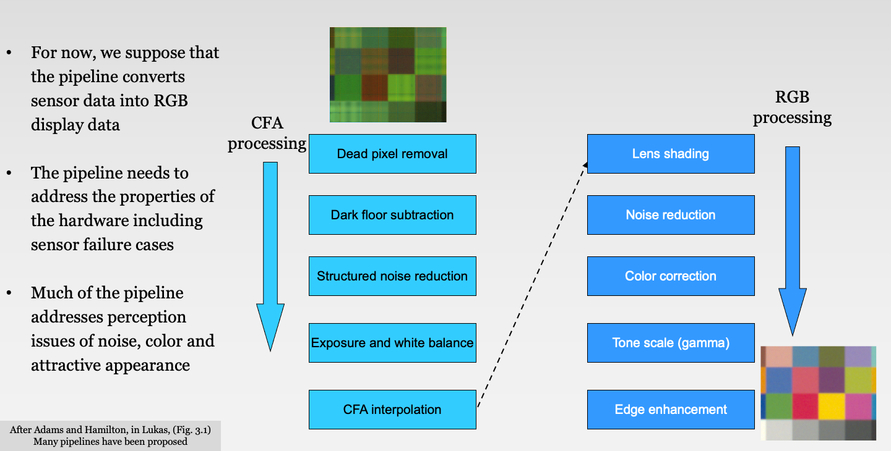
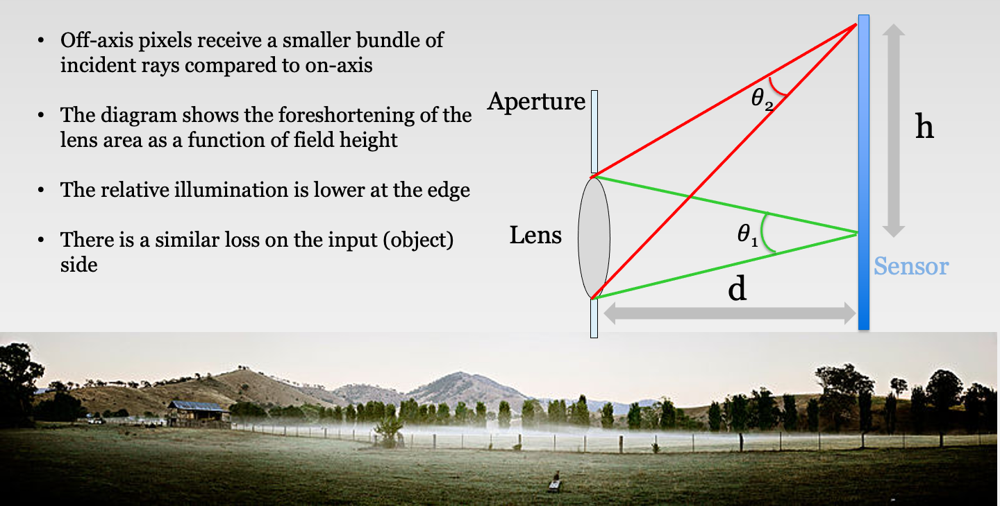
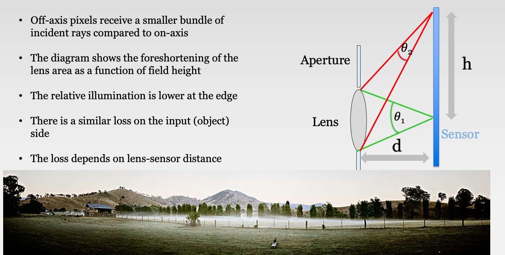

# Image processing principles {#sec-imgprocessing-principles}


## Image processing principles overview {#sec-imgprocessing-principles-overview}

This chapter bridges the raw, mosaicked sensor measurements introduced in the sensor chapters and the trichromatic display representations introduced in @sec-display-principles-overview.

{#fig-ip-overview width="70%"}

## Lens shading

Make a panel tabset of these.

{#fig-lens-shading}

{#fig-lens-shading}

## Acquisition policies

## Demosaicking

Space-color correlations?

## Color processing

### Sensor correction

### Illuminant correction

